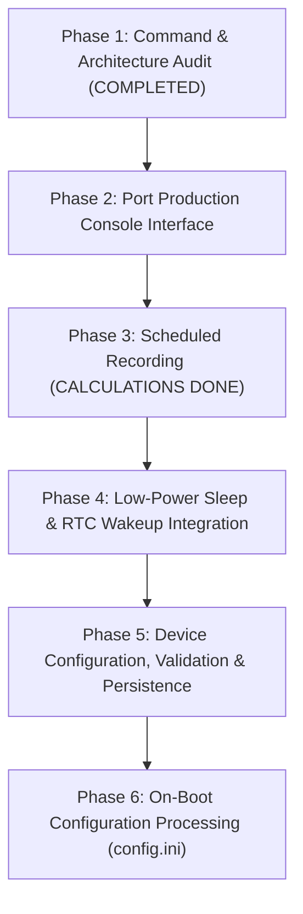

# WildSonic Command & Architecture Audit: Maxim MAX78000 to STM32L476RG

## Executive Summary

This document establishes the authoritative specification for porting the WildSonic firmware from the dual-core Maxim MAX78000 to the STM32L476RG running Zephyr RTOS v4.5.0-rc2.

The reference implementation is audited directly from `WildSonic_Firmware-feature-dev.zip`, specifically `app/console.cpp`, `app/AudioTask.cpp`, `lib/config/device_config.cpp`, and `constants.hpp`.

---

## 1. Complete Command Mapping Table

The original Maxim firmware registers 59 command IDs in `console_config_cmd_t` (`app/console.cpp:51-115`) with corresponding text identifiers in `console_cmd_lookup_table` and description strings in `console_cmd_description_table`.

Below is the comprehensive audit and mapping of every command:

| # | Maxim Command | Maxim Description / Behavior | Existing STM32 Status | Target Category | Proposed Porting Action |
| :- | :--- | :--- | :--- | :--- | :--- |
| 1 | `HELP` | Prints list of available commands and descriptions (`%s : %s\n`) | `help` (prints development command list) | **Production Product** | Standardize help format to match WildSonic. In `PRODUCTION`, list only product commands. In `TEST`, append engineering commands. |
| 2 | `SN` | Get/Set device serial number string | None | **Production Product** | Port string getter/setter into DeviceConfig data model. |
| 3 | `DNAME` | Set device name for BLE advertising | None | **Hardware-Specific / Deferred** | Defer: STM32L476RG base board does not include a BLE transceiver. |
| 4 | `PW` | Set device password for server authentication | None | **Production Product** | Port string getter/setter into DeviceConfig data model. |
| 5 | `SMSKW` | Set SMS keyword for manufacturing | None | **Hardware-Specific / Deferred** | Defer: Cellular modem not present on STM32 target. |
| 6 | `SMSKEY` | Set SMS key for manufacturing | None | **Hardware-Specific / Deferred** | Defer: Cellular modem not present on STM32 target. |
| 7 | `A2PPHONE` | Set server phone number to receive messages | None | **Hardware-Specific / Deferred** | Defer: Requires cellular GSM hardware. |
| 8 | `P2APHONE` | Set server phone number to send messages | None | **Hardware-Specific / Deferred** | Defer: Requires cellular GSM hardware. |
| 9 | `SURL` | Set server URL (without http:// or https://) | None | **Hardware-Specific / Deferred** | Defer: Requires cellular GSM/TCP stack. |
| 10 | `SPORT` | Set server port (numeric) | None | **Hardware-Specific / Deferred** | Defer: Requires cellular GSM/TCP stack. |
| 11 | `POSTROUTE` | Set server POST request API route | None | **Hardware-Specific / Deferred** | Defer: Requires cellular GSM/TCP stack. |
| 12 | `POSTCTNT` | Set server POST request content-type | None | **Hardware-Specific / Deferred** | Defer: Requires cellular GSM/TCP stack. |
| 13 | `STEST` | Quick setup for test server parameters | None | **Hardware-Specific / Deferred** | Defer: Requires cellular GSM/TCP stack. |
| 14 | `SWS` | Quick setup for demo server parameters | None | **Hardware-Specific / Deferred** | Defer: Requires cellular GSM/TCP stack. |
| 15 | `GSM` | Set GSM transmission mode (2G, 3G, 4G) | None | **Hardware-Specific / Deferred** | Defer: Requires cellular GSM modem. |
| 16 | `SAMF` | Get/Set sampling frequency in Hz (16k, 32k, 44.1k, 48k, 96k, 192k) | `rate` / `samf` | **Production Product** | Adopt `SAMF` as canonical command. Map to `audio_in_set_rate()`. Validate rate dividers. |
| 17 | `RECT` | Get/Set recording duration in seconds (1..86400) | `record` / `rect` | **Production Product** | Adopt `RECT` as canonical command. Remove development `record`. |
| 18 | `SLEEP` | Get/Set inter-session sleep duration in seconds (0..86400) | `sleep` | **Production Product** | Adopt `SLEEP`. Retain underlying sleep/standby logic. |
| 19 | `DATERANGE` | Get/Set recording calendar date range (`YYYY/MM/DD-YYYY/MM/DD` or `clear`) | `daterange` | **Production Product** | Preserved from Phase 1. Inclusive end date semantics verified. |
| 20 | `TIMEOFDAY` | Get/Set up to 10 time-of-day windows (`[index] HH:MM:SS-HH:MM:SS` or `clear`) | `timeofday` / `tod` | **Production Product** | Preserved from Phase 1. Up to 10 sorted/merged windows supported. |
| 21 | `DAYSOFWEEK` | Get/Set active days of week (`"MTWRFSU"` or `all`/`none`) | `daysofweek` / `dow` | **Production Product** | Preserved from Phase 1. Bit 0=Mon through Bit 6=Sun (`0x7F`). |
| 22 | `DATETIME` | Get/Set system date and time (`YYYY-MM-DD HH:MM:SS [[+-]ZZZZ]`) | `time` | **Production Product** | Replace `time show/set` with canonical `DATETIME [YYYY-MM-DD HH:MM:SS [+-HH:MM]]`. |
| 23 | `TIMEZONE` | Get/Set timezone offset (`[[+-]ZZZZ]` or `[+-]HH:MM`) | `timezone` / `tz` | **Production Product** | Adopt `TIMEZONE` as canonical command. |
| 24 | `BTPS` | Get/Set bits per sample (16) | None | **Production Product** | Report `16` (ADC 12-bit oversampled to 16-bit PCM). |
| 25 | `NUMCH` | Get/Set number of channels (1 = mono) | None | **Production Product** | Report `1` (single electret microphone on PA0/ADC1_IN5). |
| 26 | `GAIN` | Get/Set audio gain in dB | `gain` | **Production Product** | Map input dB to software digital gain multiplier ($Gain_{lin} = 10^{dB/20}$). |
| 27 | `LCUTOFF` | Get/Set lower cutoff frequency in Hz (HPF) | `filter hpf <Hz>` | **Production Product** | Map to DSP Stage 2 Butterworth HPF (10 to 2000 Hz). |
| 28 | `UCUTOFF` | Get/Set upper cutoff frequency in Hz (LPF) | `filter lpf <Hz>` | **Production Product** | Map to DSP Stage 5 Butterworth LPF (1000 to 40000 Hz). |
| 29 | `FLDR` | Get/Set SD folder structure (hourly, daily, flat) | None | **Production Product** | Port directory layout selection (`FLDR flat`, `FLDR daily`). |
| 30 | `APPLY` | Write staged RAM configuration to non-volatile flash | None | **Production Product** | Port in Phase 5 with verified flash page allocation. |
| 31 | `RBT` | Reboot the device via system reset | None | **Production Product** | Map to `sys_reboot(SYS_REBOOT_COLD)`. |
| 32 | `ARBT` | Apply settings to flash and reboot | None | **Production Product** | Port in Phase 5 after flash persistence is implemented. |
| 33 | `SDFMT` | Format SD card filesystem | None | **Production Product** | Format FatFS storage using Zephyr `fs_mkfs()`. |
| 34 | `SMSFREQ` | SMS upload frequency in seconds | None | **Hardware-Specific / Deferred** | Defer: Requires cellular modem. |
| 35 | `ASSERT` | Provides assertion failure / crash information | `print_reset_reason()` | **Production Product** | Report reset reason (`RCC->CSR`) and hardware fault status. |
| 36 | `BATT` | Provides battery status and voltage | None | **Hardware-Specific / Deferred** | Defer: NUCLEO is USB/VIN powered; no on-board MAX17260 fuel gauge. |
| 37 | `SIG` | Provides GSM signal quality (RSSI/CSQ) | None | **Hardware-Specific / Deferred** | Defer: Requires cellular modem. |
| 38 | `STOR` | Provides number of bytes filled and free on SD card | `print_status()` | **Production Product** | Map to `fs_statvfs("/SD:", &stat)` to report total and free bytes. |
| 39 | `LBAT` | Set low battery voltage threshold (in mV) | None | **Hardware-Specific / Deferred** | Defer: No battery fuel gauge. |
| 40 | `NUMBAT` | Set number of battery cells | None | **Hardware-Specific / Deferred** | Defer: No battery fuel gauge. |
| 41 | `FULLCAP` | Set fuel gauge full capacity in mAh | None | **Hardware-Specific / Deferred** | Defer: Requires MAX17260 fuel gauge. |
| 42 | `SENDSTS` | Sends status packet to remote server now | None | **Hardware-Specific / Deferred** | Defer: Requires cellular modem. |
| 43 | `AUDIO` | Displays audio parameters summary | `print_settings()` | **Production Product** | Adopt `AUDIO` to print summary of sample rate, channels, bits, gain, and DSP filters. |
| 44 | `BLEPAIR` | Open BLE pairing window (seconds) | None | **Hardware-Specific / Deferred** | Defer: No BLE controller on target. |
| 45 | `Wildly` | Dummy command; ignored | None | **Production Product** | Ignore silently to match Maxim behavior. |
| 46 | `VERSION` | Provides firmware version and git commit hash | None | **Production Product** | Report WildSonic STM32L476RG version, Zephyr version, and build timestamp. |
| 47 | `ENVSTS` | Temperature and humidity environmental sensor status | None | **Hardware-Specific / Deferred** | Defer: Target board lacks AHT20 / SHT3x sensor. |
| 48 | `LOC` | Get/Set latitude and longitude | None | **Hardware-Specific / Deferred** | Defer: Sun mode calculations deferred until GPS/location mapping. |
| 49 | `SUN` | View Sunrise/Sunset times for a date | None | **Hardware-Specific / Deferred** | Defer: Solar algorithm deferred per task scope. |
| 50 | `SUNMODE` | Set sun recording mode (disabled, sunrise, sunset, both) | None | **Hardware-Specific / Deferred** | Defer: Solar algorithm deferred per task scope. |
| 51 | `SUNRISEBEF` | Set sunrise interval before (minutes) | None | **Hardware-Specific / Deferred** | Defer: Solar algorithm deferred per task scope. |
| 52 | `SUNRISEAFT` | Set sunrise interval after (minutes) | None | **Hardware-Specific / Deferred** | Defer: Solar algorithm deferred per task scope. |
| 53 | `SUNSETBEF` | Set sunset interval before (minutes) | None | **Hardware-Specific / Deferred** | Defer: Solar algorithm deferred per task scope. |
| 54 | `SUNSETAFT` | Set sunset interval after (minutes) | None | **Hardware-Specific / Deferred** | Defer: Solar algorithm deferred per task scope. |
| 55 | `SUNROUND` | Set sunrise/sunset rounding (minutes) | None | **Hardware-Specific / Deferred** | Defer: Solar algorithm deferred per task scope. |
| 56 | `DEFAULT` | Reset all configuration parameters to factory defaults | `default` | **Production Product** | Adopt canonical uppercase `DEFAULT`. |
| 57 | `I2C` | Debugging I2C bus scan, read, write | None | **Hardware-Specific / Deferred** | Maxim-specific peripheral debug tool. |
| 58 | `RTCRST` | Reset RTC time to 2025-01-01 00:00:00 UTC | None | **Hardware-Specific / Deferred** | Target uses STM32 internal RTC; reset achieved via `DATETIME 2025-01-01 00:00:00`. |
| 59 | `TEST_ALARM` | Test alarm sequence command (MCP7940 external RTC) | None | **Hardware-Specific / Deferred** | Target lacks external MCP7940; on-chip RTC wakeup timer used instead. |

---

## 2. STM32 Development Command Audit (Build Separation)

The current STM32 project contains several development, diagnostic, and benchmark commands created during the initial audio pipeline bring-up. The table below defines their strict build separation:

| STM32 Command | Existing Role | PRODUCTION Build Action | TEST Build Action |
| :--- | :--- | :--- | :--- |
| `start` | Immediate audio recording trigger | **REMOVE** from production console (recording is autonomous via scheduler/boot) | **RETAIN** as engineering test command |
| `stop` | Stop active recording via CLI string | **REMOVE** from production console (stop via `'q'`, `ESC`, or `Ctrl+C` interrupt keys) | **RETAIN** as engineering command |
| `record` | Set recording duration | **REMOVE** (replaced by canonical product command `RECT`) | Alias to `RECT` |
| `rate` | Set sampling rate | **REMOVE** (replaced by canonical product command `SAMF`) | Alias to `SAMF` |
| `time` | Show or set calendar | **REMOVE** (replaced by canonical product command `DATETIME`) | Alias to `DATETIME` |
| `bench` | Memory, CPU, ADC, PSRAM, SD benchmarks | **EXCLUDE** (guarded by `#if CONFIG_AUDIO_BENCHMARK`) | **RETAIN** (enabled by `test_benchmark.conf`) |
| `diagnose` | Stage isolation diagnostics (A..E) | **EXCLUDE** (guarded by `#if CONFIG_AUDIO_STAGE_DIAGNOSTICS`) | **RETAIN** (enabled by `test_diagnostics.conf`) |
| `compare` | Raw vs Filtered dual-cycle mode | **EXCLUDE** (guarded by `#if CONFIG_AUDIO_STAGE_DIAGNOSTICS`) | **RETAIN** (enabled by `test_diagnostics.conf`) |
| `stress` | Rapid 5s/3s multi-cycle stress test | **EXCLUDE** (guarded by `#if CONFIG_AUDIO_STAGE_DIAGNOSTICS`) | **RETAIN** (enabled by `test_diagnostics.conf`) |
| `integrity` | Deterministic PCM to SD CRC readback | **EXCLUDE** (guarded by `#if CONFIG_AUDIO_INTEGRITY_REPLAY`) | **RETAIN** (enabled by `test_integrity_replay.conf`) |
| `psram test` | Multi-pass memory self-test | **EXCLUDE** (guarded by `#if CONFIG_AUDIO_BENCHMARK \|\| CONFIG_AUDIO_STAGE_DIAGNOSTICS`) | **RETAIN** |
| `psram diag` | 10-pattern diagnostic matrix | **EXCLUDE** (guarded by `#if CONFIG_AUDIO_BENCHMARK \|\| CONFIG_AUDIO_STAGE_DIAGNOSTICS`) | **RETAIN** |
| `psram sshift` | QSPI sample shifting probe | **EXCLUDE** (guarded by `#if CONFIG_AUDIO_BENCHMARK \|\| CONFIG_AUDIO_STAGE_DIAGNOSTICS`) | **RETAIN** |
| `psram bench` | PSRAM throughput benchmark | **EXCLUDE** (guarded by `#if CONFIG_AUDIO_BENCHMARK`) | **RETAIN** |
| `psram on/off` | Quick toggle for PSRAM buffer | **RETAIN** as product storage tuning command | **RETAIN** |
| `config` | Guided interactive wizard | **RETAIN** as user-friendly configuration wizard | **RETAIN** |
| `schedule` | Schedule audit and manual trigger | **RETAIN** (`schedule show`, `schedule check`, `schedule reset`, `schedule run`) | **RETAIN** |

---

## 3. Proposed File-Structure Architecture

To align with the logical architecture of the original WildSonic firmware while maintaining Zephyr application integrity:

```text
app/
├── CMakeLists.txt              # Build system definition
├── Kconfig                     # Project Kconfig tree (benchmark, diagnostics, integrity)
├── prj.conf                    # Production base configuration
├── boards/
│   └── nucleo_l476rg.overlay   # Device tree (TIM6, ADC1, QSPI, Console UART)
├── configs/
│   ├── test_benchmark.conf     # TEST build fragment (CONFIG_AUDIO_BENCHMARK=y)
│   ├── test_diagnostics.conf   # TEST build fragment (CONFIG_AUDIO_STAGE_DIAGNOSTICS=y)
│   ├── test_integrity_replay.conf # TEST build fragment (CONFIG_AUDIO_INTEGRITY_REPLAY=y)
│   └── test_synth.conf         # TEST build fragment (synthetic calibration tone)
├── sd/
│   └── sdmmc_nucleo_l476rg.overlay # Native 4-bit SDMMC bus devicetree
└── src/
    ├── main.c                  # Boot entry, reset cause evaluation, REPL thread
    ├── console.h               # WildSonic canonical command interface
    ├── console.c               # Lookup table, token parser, help formatter, dispatcher
    ├── device_config.h         # Production configuration data model & limits
    ├── device_config.c         # Parameter validation, default page, staging getters/setters
    ├── scheduler.h             # Pure calendar/TOD calculation interfaces
    ├── scheduler.c             # Pure calculation engine (epoch, weekday, 10 TOD, intervals)
    ├── recorder.h              # Audio recording orchestration interface
    ├── recorder.c              # Capture lifecycle, buffer queueing, WAV writer
    ├── audio_in.h              # Low-level audio acquisition interface
    ├── audio_in_stm32l4.c      # STM32L4 ADC1 + TIM6 TRGO + DMA1 circular engine
    ├── dsp.h                   # 5-stage biquad cascade DSP filter chain & gain
    ├── dsp.c                   # Direct Form II Transposed biquads (Hardware FPU)
    ├── psram_is66wvs.h         # ISSI IS66WVS4M8 QSPI driver
    ├── psram_is66wvs.c         # Quad-SPI memory read/write & self-test
    ├── psram_staging.h         # Real-time circular staging buffer
    ├── psram_staging.c         # PSRAM staging queue & SD flush batching
    ├── rtc_calendar.h          # STM32 on-chip RTC calendar driver
    ├── rtc_calendar.c          # LL RTC calendar get/set/validate
    ├── rtc_sleep.h             # Low-power sleep & RTC wakeup timer
    ├── rtc_sleep.c             # Stop 2 mode entry & EXTI 20 wakeup configuration
    ├── wav.h                   # RIFF WAV file writer & structure validation
    ├── wav.c                   # WAV header creation, block commit, file verification
    └── diagnostics/            # Test-only benchmark and diagnostic implementations
        ├── benchmark.h         # SRAM, CPU, ADC, PSRAM, SD benchmarks
        └── benchmark.c         # Benchmark execution routines
```

---

## 4. Progressive Implementation Plan



### Phase 2 Scope (Immediate Next Phase)
1. Implement `app/src/console.h` and `app/src/console.c` based on Maxim `console.cpp`.
2. Register canonical WildSonic commands: `HELP`, `SAMF`, `RECT`, `SLEEP`, `DATERANGE`, `TIMEOFDAY`, `DAYSOFWEEK`, `DATETIME`, `TIMEZONE`, `GAIN`, `LCUTOFF`, `UCUTOFF`, `AUDIO`, `STOR`, `VERSION`, `DEFAULT`, `RBT`, `ASSERT`.
3. Provide exact Maxim query/set behavior (`\nValue is set to <val>\n`).
4. Strict build separation:
   - In `PRODUCTION`: commands `start`, `stop`, `record`, `bench`, `diagnose`, `compare`, `stress`, `integrity` are completely absent from the console lookup table and help output.
   - In `TEST`: engineering commands (`bench`, `diagnose`, `compare`, `stress`, `integrity`, `start`, `stop`) are conditionally registered under `#if CONFIG_AUDIO_...`.
5. Maintain 100% passing status across the existing 45 host tests and compile both `build/prod` and `build/test`.

