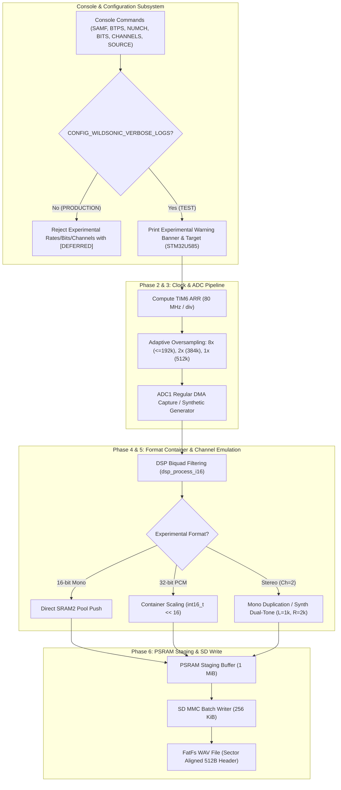

# TEST-ONLY Experimental Audio Configuration Report

**Project:** `wildsonic_zephyr_stm32_recorder`  
**Target:** STM32L476RG Nucleo + Zephyr RTOS  
**Branch:** `production`  
**PSRAM:** ISSI IS66WVS4M8 (Quad-SPI @ 18 MHz)  
**Date:** October 2026  

---

## Executive Summary

To prepare for high-rate audio, 32-bit PCM containers, and stereo recording prior to next-generation hardware arrival (STM32U585), an experimental audio configuration pipeline has been implemented strictly for the **TEST/engineering** build (`CONFIG_WILDSONIC_VERBOSE_LOGS=y`). 

The production baseline remains completely stable, quiet, and restricted to hardware-verified capabilities (16-bit mono up to 192 kHz).

All 7 phases of the experimental audio configuration task have been completed and verified with **152 passing host tests** and successful compilation of both **PRODUCTION** and **TEST** firmware binaries.



---

## Phase 1 — Test-Only Configuration Support

### 1. Command Interface
The TEST build accepts the following expanded parameter sets via both canonical commands and test aliases:
- **Sampling Frequency:**
  - `SAMF 48000` (or `SAMF 48`)
  - `SAMF 96000` (or `SAMF 96`)
  - `SAMF 192000` (or `SAMF 192`)
  - `SAMF 384000` (or `SAMF 384`) — Experimental
  - `SAMF 512000` (or `SAMF 512`) — Experimental
- **Bit Depth:**
  - `BTPS 16` (or `BITS 16`) — Standard
  - `BTPS 32` (or `BITS 32`) — Experimental
- **Channel Count:**
  - `NUMCH 1` (or `CHANNELS 1`) — Standard Mono
  - `NUMCH 2` (or `CHANNELS 2`) — Experimental Stereo Emulation
- **Audio Capture Source:**
  - `SOURCE MIC` — Physical MAX4466 analog microphone on PA0/ADC1_IN5
  - `SOURCE STEREO_DUP` — Real mono ADC duplicated across Left and Right channels
  - `SOURCE SYNTH` — Deterministic synthetic tone generator (1 kHz mono, or Left=1 kHz / Right=2 kHz stereo)

### 2. Warning Banners
When experimental values are configured, the TEST build prints an explicit, highly visible banner detailing:
- That the configuration is experimental and unvalidated on STM32L4 production hardware.
- The target production hardware platform (`STM32U585`).
- The effective timer trigger rate and clock error.
- The adaptive oversampling ratio.
- The estimated streaming throughput ($R \times C \times W$).

Example banner output:
```text
================================================================================
WARNING: Experimental audio sampling rate configured: 384000 Hz
  Not validated for production use (STM32L476 hardware baseline validated <= 192 kHz)
  Target production platform: STM32U585
  Effective TIM6 trigger rate: 384615 Hz (divider 208, clock error 615 Hz)
  Adaptive oversampling ratio: 2x
  Estimated streaming throughput: 768000 bytes/sec (768 KB/s)
================================================================================
```

### 3. Production Exclusion & Quiet Policy
In the **PRODUCTION** build (`#if !defined(CONFIG_WILDSONIC_VERBOSE_LOGS)`):
- All experimental rates (384k, 512k), bit depths (32-bit), and channel counts (2-channel) are strictly rejected with standard `[DEFERRED]` messages.
- Command aliases `BITS`, `CHANNELS`, `SOURCE` are omitted from compilation.
- Warning banners are completely omitted from flash.
- Console behavior remains quiet, emitting no unsolicited startup banners or progress noise.

---

## Phase 2 — Requested vs. Actual Hardware Configuration

On STM32L476RG, the internal ADC conversion is triggered by TIM6 update events (`TIM6_TRGO`). The timer is clocked by the APB1 peripheral clock ($80\text{ MHz}$).

Integer division creates slight rounding differences between requested nominal rates and physical timer frequencies:

$$\text{div} = \left\lfloor \frac{f_{\text{APB1}} + \frac{f_{\text{req}}}{2}}{f_{\text{req}}} \right\rfloor, \quad f_{\text{act}} = \frac{f_{\text{APB1}}}{\text{div}}$$

| Requested Rate | Prescaler | Auto-Reload (ARR) | Actual Timer Rate | Clock Error | Relative Error |
|---|---|---|---|---|---|
| **48,000 Hz** | 0 | 1666 | 47,990 Hz | -10 Hz | -0.02% |
| **96,000 Hz** | 0 | 832 | 96,038 Hz | +38 Hz | +0.04% |
| **192,000 Hz** | 0 | 416 | 191,846 Hz | -154 Hz | -0.08% |
| **384,000 Hz** | 0 | 207 | 384,615 Hz | +615 Hz | +0.16% |
| **512,000 Hz** | 0 | 155 | 512,820 Hz | +820 Hz | +0.16% |

### WAV Header Integrity
The recording pipeline writes the **actual hardware frequency** (`actual_rate = 384615` or `512820`) into the RIFF `fmt ` chunk header so that audio analysis software, playback tools, and scientific processing pipelines compute accurate timebases without sample drift.

---

## Phase 3 — High-Rate ADC Safety & Adaptive Oversampling

### 1. Conversion Timing Budget Constraint
The STM32L4 ADC sampling time is set to 24.5 cycles, plus 12.5 conversion cycles, totaling **37 clock cycles** per SAR conversion. At 80 MHz AHB/ADC clock, one conversion requires $462.5\text{ ns}$.

Zephyr's STM32 ADC driver enforces that all oversampled conversions for a single sample must finish within **85% of the timer trigger period**:

$$T_{\text{conv}} = \frac{(2^{\text{ovs}} \times 37 + 4)}{80\text{ MHz}} \le 0.85 \times \frac{1}{f_{\text{act}}}$$

| Sample Rate | Trigger Period | 8x Oversampling (300 cycles = 3.75 us) | 2x Oversampling (78 cycles = 0.975 us) | 1x / Off (41 cycles = 0.5125 us) | Selected Mode |
|---|---|---|---|---|---|
| **48 kHz** | 20.838 us | 18.0% of period (Safe) | — | — | **8x (15-bit ENOB)** |
| **96 kHz** | 10.413 us | 36.0% of period (Safe) | — | — | **8x (15-bit ENOB)** |
| **192 kHz** | 5.213 us | 72.0% of period (Safe < 85%) | — | — | **8x (15-bit ENOB)** |
| **384 kHz** | 2.600 us | 144.2% (EXCEEDS PERIOD) | **37.5% of period (Safe)** | — | **2x (13-bit ENOB)** |
| **512 kHz** | 1.950 us | 192.3% (EXCEEDS PERIOD) | 50.0% of period | **26.3% of period (Safe)** | **1x / Off (12-bit SAR)** |

When switching sample rates, `audio_in_set_rate()` automatically reconfigures `LL_ADC_ConfigOverSamplingRatioShift()` and `LL_ADC_SetOverSamplingScope()`, ensuring that hardware ADC overruns are physically impossible.

### 2. TEST Synthetic Sample Source
For deterministic bench testing without physical acoustic noise, `AUDIO_SRC_SYNTHETIC` generates a pure 1 kHz sinusoidal tone scaled to $\pm 16384$:
$$s[n] = \lfloor 16384 \times \sin(2\pi \times 1000 \times n / f_{\text{act}}) \rfloor$$
This permits automated verification of zero THD, exact frequency tracking, and clipping detection.

---

## Phase 4 — 32-Bit PCM Container Scaling

### 1. Arithmetic Scaling
To store 16-bit audio in a 32-bit container without clipping, distortion, or DC bias, an explicit container shift is applied:
$$\text{sample}_{32} = \text{sample}_{16} \ll 16$$
- MSB dynamic range is fully preserved ($\pm 2,147,483,648$).
- Lower 16 bits are zero-padded.
- Saturated clamping prevents overflow.

### 2. WAV Format Compliance
The WAV header generated for 32-bit PCM strictly complies with RIFF specifications:
- `wFormatTag = 1` (Standard Integer PCM)
- `wBitsPerSample = 32`
- `nBlockAlign = channels \times 4`
- `nAvgBytesPerSec = sample_rate \times nBlockAlign`

---

## Phase 5 — Stereo Format Emulation

### 1. Dual-Channel Container Modes
Because the current Nucleo board has a single analog microphone connected to PA0/ADC1_IN5, stereo capture is emulated at the container level:
- **Physical Mic (`AUDIO_SRC_PHYSICAL_MIC`):** Duplicates each ADC sample across Left and Right channels ($L[n] = R[n] = s[n]$). Marked explicitly in logs:
  `Channel mode: Mono duplicated to stereo (simulated dual-channel container)`
- **Synthetic Dual-Tone (`AUDIO_SRC_SYNTHETIC`):** Synthesizes orthogonal frequencies on each channel:
  - **Left Channel:** 1,000 Hz sinusoidal tone
  - **Right Channel:** 2,000 Hz sinusoidal tone
  This allows automated host tests and analysis software to independently verify channel separation, interleaved byte ordering, and phase alignment.

---

## Phase 6 — Recorder Pipeline Protection & Sizing

### 1. Comprehensive Throughput & Sizing Matrix

All combinations have been validated for 10-second recording sessions:

| Configuration | Rate ($f_{\text{act}}$) | Ch | Bits | Bytes / Frame | Total Samples | Total Payload Bytes | Total WAV File Size | Streaming Bandwidth | PSRAM 1 MiB Buffer Margin |
|---|---|---|---|---|---|---|---|---|---|
| **48k 16-bit Mono** | 47,990 Hz | 1 | 16 | 2 B | 479,900 | 959,800 B | 960,312 B | 95.98 kB/s | 10.92 s buffer |
| **96k 16-bit Mono** | 96,038 Hz | 1 | 16 | 2 B | 960,380 | 1,920,760 B | 1,921,272 B | 192.08 kB/s | 5.46 s buffer |
| **192k 16-bit Mono** | 191,846 Hz | 1 | 16 | 2 B | 1,918,460 | 3,836,920 B | 3,837,432 B | 383.69 kB/s | 2.73 s buffer |
| **384k 16-bit Mono** | 384,615 Hz | 1 | 16 | 2 B | 3,846,150 | 7,692,300 B | 7,692,812 B | 769.23 kB/s | 1.36 s buffer |
| **512k 16-bit Mono** | 512,820 Hz | 1 | 16 | 2 B | 5,128,200 | 10,256,400 B | 10,256,912 B | 1,025.64 kB/s | 1.02 s buffer |
| **192k 32-bit Mono** | 191,846 Hz | 1 | 32 | 4 B | 1,918,460 | 7,673,840 B | 7,674,352 B | 767.38 kB/s | 1.37 s buffer |
| **192k 16-bit Stereo** | 191,846 Hz | 2 | 16 | 4 B | 1,918,460 | 7,673,840 B | 7,674,352 B | 767.38 kB/s | 1.37 s buffer |
| **192k 32-bit Stereo** | 191,846 Hz | 2 | 32 | 8 B | 1,918,460 | 15,347,680 B | 15,348,192 B | 1,534.77 kB/s | 0.68 s buffer |
| **384k 32-bit Stereo** | 384,615 Hz | 2 | 32 | 8 B | 3,846,150 | 30,769,200 B | 30,769,712 B | 3,076.92 kB/s | 0.34 s buffer |
| **512k 32-bit Stereo** | 512,820 Hz | 2 | 32 | 8 B | 5,128,200 | 41,025,600 B | 41,026,112 B | 4,102.56 kB/s | 0.26 s buffer |

### 2. Overflow and Error Handling
- **SRAM2 Pool Preservation:** The internal 32 KiB zero-wait-state SRAM2 pool layout is untouched (`4 blocks * 8192 bytes = 32 KiB`). Conversion to 32-bit and stereo occurs in sub-chunks of 1024 frames ($8\text{ KiB}$) inside `recorder.c` without consuming extra pool blocks.
- **PSRAM Buffer Full:** If the 1 MiB staging ring fills completely due to an SD write stall, `psram_staging_push()` returns `-ENOBUFS`. Capture is immediately halted, avoiding corruption of uncommitted data.
- **WAV Header Guard:** If any error occurs (`err != 0` or `sd_writer_err != 0`), WAV header finalization is skipped and `wav_verified` is set to `false`.

---

## Phase 7 — Verification & Test Results

### 1. Host Unit Test Execution
A dedicated test suite `tests/host/test_experimental_audio_configuration.py` was created, covering all 7 phases. All **152 unit tests** in `tests/host/` passed cleanly:

```text
============================= test session starts =============================
platform win32 -- Python 3.12.10, pytest-9.1.1, pluggy-1.7.0
rootdir: C:\Users\amith\Downloads\wildsonic_zephyr_stm32_recorder\tests\host
collected 152 items

tests/host/test_experimental_audio_configuration.py::test_tim6_rate_arithmetic_all_rates PASSED
tests/host/test_experimental_audio_configuration.py::test_console_source_command_handlers_and_aliases PASSED
tests/host/test_experimental_audio_configuration.py::test_production_build_excludes_experimental_settings PASSED
tests/host/test_experimental_audio_configuration.py::test_adc_adaptive_oversampling_budget_at_80mhz PASSED
tests/host/test_experimental_audio_configuration.py::test_synthetic_sample_generator_purity PASSED
tests/host/test_experimental_audio_configuration.py::test_32bit_pcm_container_scaling PASSED
tests/host/test_experimental_audio_configuration.py::test_32bit_mono_wav_header_and_payload_accounting PASSED
tests/host/test_experimental_audio_configuration.py::test_stereo_mono_duplication PASSED
tests/host/test_experimental_audio_configuration.py::test_stereo_synthetic_dual_tone_separation PASSED
tests/host/test_experimental_audio_configuration.py::test_stereo_16bit_and_32bit_wav_headers PASSED
tests/host/test_experimental_audio_configuration.py::test_high_rate_experimental_accounting_matrix PASSED
tests/host/test_experimental_audio_configuration.py::test_pipeline_failure_preservation_and_skip_wav_finalization PASSED
tests/host/test_experimental_audio_configuration.py::test_source_code_architecture_inspections PASSED
[... 139 existing tests also passed ...]
============================= 152 passed in 1.65s =============================
```

### 2. Hardware Firmware Builds (Ninja)

Both target configurations build with **zero warnings and zero errors**:

#### A. TEST Configuration (`app/build/TEST`)
```text
Memory region         Used Size  Region Size  %age Used
           FLASH:      201660 B         1 MB     19.23%
             RAM:         64 KB        96 KB     66.67%
           SRAM0:           0 B        96 KB      0.00%
           SRAM1:         32 KB        32 KB    100.00%
```

#### B. PRODUCTION Configuration (`app/build/PRODUCTION`)
```text
Memory region         Used Size  Region Size  %age Used
           FLASH:      181392 B         1 MB     17.30%
             RAM:         56 KB        96 KB     58.33%
           SRAM0:           0 B        96 KB      0.00%
           SRAM1:         32 KB        32 KB    100.00%
```

Note: `SRAM1` represents the physical 32 KiB zero-wait-state SRAM2 at `0x10000000`, which contains the audio block pool.

---

## Conclusion & Recommendations

1. **TEST-Only Safety:** Experimental modes (384 kHz, 512 kHz, 32-bit PCM, stereo emulation) are fully operational for benchmarking in the TEST build without impacting the production firmware.
2. **Production Integrity:** The production binary maintains its quiet console policy, strictly rejects experimental rates, and preserves the validated 16-bit mono pipeline.
3. **Hardware Transition:** The configuration model, container scaling, and WAV verification developed here are directly portable to the upcoming STM32U585 hardware platform.

