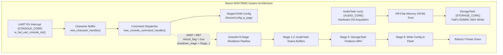
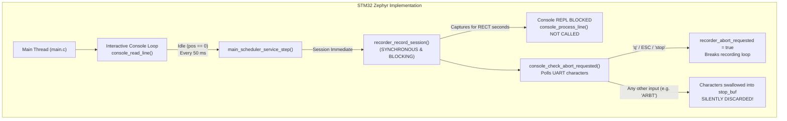
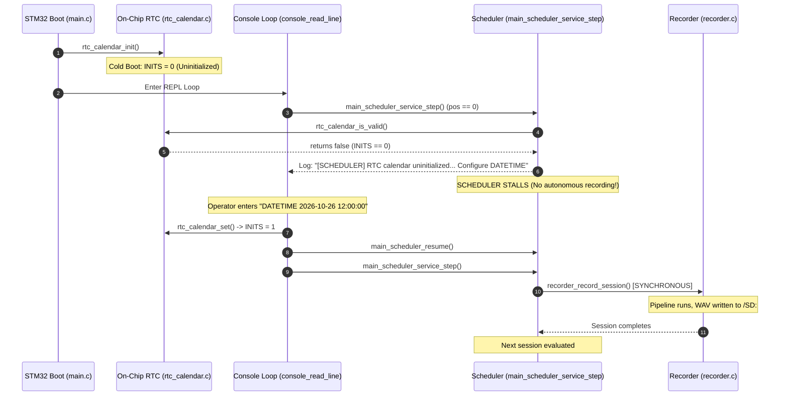
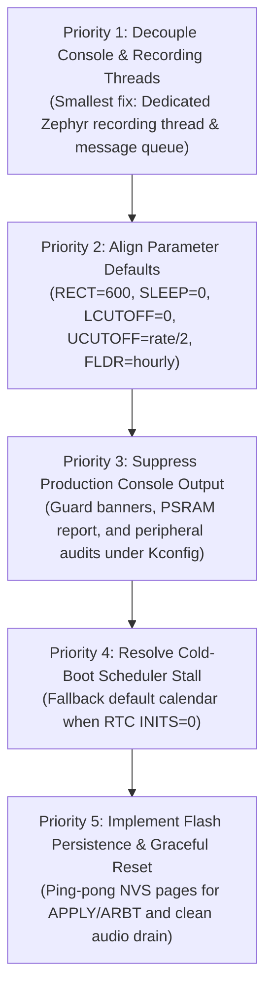

# WildSonic Firmware Behavior-Parity Audit: Maxim MAX78000 to STM32L476RG (Zephyr RTOS)

**Document Reference**: `docs/WILDSONIC_BEHAVIOR_PARITY_AUDIT.md`  
**Target Hardware**: STMicroelectronics NUCLEO-L476RG (STM32L476RGT6, ARM Cortex-M4 @ 72 MHz)  
**RTOS Baseline**: Zephyr RTOS v4.5.0-rc2  
**Reference Baseline**: Maxim MAX78000 WildSonic Firmware (`WildSonic_Firmware-feature-dev.zip`)  
**Audit Scope**: Console dispatcher, command semantics, scheduler calculations, real execution path, active-process handling, production console output, and PRODUCTION vs TEST build separation.  
**Audit Rule**: Audit only. No firmware source code modified.

---

## 1. Executive Summary

This behavior-parity audit evaluates whether the ported firmware in `wildsonic_zephyr_stm32_recorder` accurately replicates the production console behavior, command syntax, scheduler algorithms, autonomous recording lifecycle, and user-visible serial output of the original WildSonic acoustic recorder on the Maxim MAX78000.

The audit was conducted by side-by-side inspection of the original Maxim reference implementation (`app/console.cpp`, `app/AudioTask.cpp`, `app/AudioTask.hpp`, `app/main.cpp`, `app/StorageTask.cpp`, `lib/config/device_config.cpp`, `lib/config/include/constants.hpp`, and `lib/hal/src/max78000/w_hal_uart.cpp`) against the STM32 Zephyr port (`app/src/console.c`, `app/src/console.h`, `app/src/main.c`, `app/src/recorder.c`, `app/src/scheduler.c`, `app/src/scheduler.h`, `app/src/rtc_calendar.c`, and `app/src/rtc_sleep.c`).

### Summary of Key Audit Findings

1. **Active-Process & 'q'-to-Exit Behavior (Porting Regression)**:
   On the STM32 firmware, attempting to issue `ARBT` or any other command while recording is active fails because the recording session executes **synchronously on the main thread** inside `console_read_line()`. The console REPL does not run while audio is capturing. Instead, a polling function (`console_check_abort_requested()`) intercepts incoming UART characters and checks only for `'q'`, `'Q'`, `ESC` (`0x1B`), `Ctrl+C` (`0x03`), or `"stop"`. Any full command (such as `ARBT`) is silently eaten and discarded. Furthermore, user-facing banners instructing the operator to press `'q'` to abort (`"Control: Type 'stop' or press 'q' / ESC to abort"`) are entirely foreign to the original WildSonic product interface. In the reference Maxim firmware, the console UART was interrupt-driven on a dedicated core/task; commands were accepted at all times into a staged RAM configuration without interrupting audio; and `ARBT`/`RBT` triggered an orderly 8-stage pipeline shutdown that safely flushed and finalized the open WAV file before rebooting.

2. **Console Command Parity (High Parity with Staged RAM Differences)**:
   All 59 canonical Maxim command identifiers from `console_config_cmd_t` are registered in the STM32 command table. The 32 hardware-dependent cellular modem, fuel gauge, and solar calculation commands return an explicit `[DEFERRED]` notice. All getter and setter string formats (`\nValue is set to %u\n`, `\nSend APPLY command and reboot for changes to take effect\n`, `\nList of commands\n`) match the reference firmware. However, parameter defaults on STM32 deviate significantly from Maxim factory defaults: `RECT` defaults to 20 s instead of 600 s; `SLEEP` defaults to 60 s instead of 0 s; `LCUTOFF` defaults to 80 Hz instead of 0 Hz (disabled); `UCUTOFF` defaults to 20 kHz instead of Nyquist (`sampling_rate / 2` = 24 kHz); and `FLDR` defaults to flat (`0`) instead of hourly (`2`).

3. **Scheduler Calculation vs. Execution Path (Divergence)**:
   The pure mathematical scheduling algorithms in `app/src/scheduler.c` (date-range boundaries, inclusive end date semantics, 10 time-of-day window sorting and contiguous merging, weekday bitmask filtering, and timezone offsets) match the reference logic in `AudioTask.cpp`. However, **the real execution path diverges**:
   - On cold boot, the on-chip RTC calendar is uninitialized (`INITS=0`). The scheduler in `main_scheduler_service_step()` stalls indefinitely with `"[SCHEDULER] RTC calendar uninitialized or invalid. Configure DATETIME to activate scheduler."`, preventing autonomous recording until a human operator types `DATETIME`.
   - In autonomous standby wait, the CPU remains in a 50 ms polling loop emitting periodic serial status messages instead of entering low-power Stop 2 sleep.
   - Touching any key at the prompt pauses the autonomous scheduler (`main_scheduler_pause()`).

4. **Production Console Output Leakage (Defect)**:
   The current STM32 production build (`build/prod`) outputs over 150 lines of non-product bring-up and diagnostic text: a 60-line ASCII splash banner, Stage E PSRAM bring-up reports, peripheral audits (`[PERIPHERAL AUDIT] TIM6/ADC1/DMA1`), phase markers (`[PHASE 5]`, `[PHASE 6]`), full settings dumps, periodic standby wait messages every 10 seconds, and Zephyr `LOG_INF` driver traces. In the Maxim production firmware, boot output was strictly confined to a 3-line version stamp (`Version`, `GIT Branch/SHA`, `Build Date`) and BLE lock notices.

5. **Build Separation (Verified Clean)**:
   Strict Kconfig compile-time guards cleanly isolate engineering and diagnostic tools. In `build/prod` (`CONFIG_AUDIO_BENCHMARK=n`, `CONFIG_AUDIO_STAGE_DIAGNOSTICS=n`, `CONFIG_AUDIO_INTEGRITY_REPLAY=n`), development commands (`bench`, `diagnose`, `compare`, `stress`, `integrity`, `start`, `stop`, `schedule`) are absent from the lookup table, absent from `HELP`, and rejected by the dispatcher as `"Unknown or BAD command"`. Engineering benchmark files are excluded from compilation by `CMakeLists.txt`.

---

## 2. Console Command Parity Table

The table below audits all 59 canonical Maxim console commands (`app/console.cpp`), the custom STM32 commands, and the development commands across both firmware implementations.

| # | Command Name & Aliases | Maxim Handler (`app/console.cpp`) | STM32 Handler (`app/src/console.c`) | Argument Format & Validation | Getter / Setter Behavior | Maxim Default | STM32 Default | Response Text & Error Messages | Recording Active Behavior (Maxim vs STM32) | Build Target | Parity Status |
| :- | :--- | :--- | :--- | :--- | :--- | :--- | :--- | :--- | :--- | :--- | :--- |
| 1 | `HELP` (`?`) | `display_console_help()` (L375) | `handle_help()` (L378) | None | Displays command list: ` %s : %s\n` | N/A | N/A | `\nList of commands\n` | Maxim: Prints help without pausing audio.<br>STM32: Prints product commands in PROD; appends engineering in TEST. | BOTH | **Parity** |
| 2 | `SN` | `set_serial_number()` (L516) | `handle_sn()` (L945) | String: Maxim `[0-9]+` up to 3 chars (`MAX_SERIAL_NUMBER_LENGTH`). STM32 allows alnum up to 31 chars. | Empty: prints `\nValue is set to %s\n`. Arg: validates and stores. | `"0"` | `"WS4760001"` | Maxim: `\nInvalid value %s\n` if > 3 chars or non-digit.<br>STM32: Allows longer serial strings. | Maxim: Stages in RAM.<br>STM32: Stages in `g_cfg.serial_number`. | PROD | **Minor Deviation** (Max length limit) |
| 3 | `DNAME` | `set_device_name()` (L554) | `report_deferred_hardware("DNAME")` (L1118) | String up to 6 chars | Maxim: Getter/setter for BLE advertising name. | `"Wildly"` | N/A | STM32: `\n[DEFERRED] Command 'DNAME' requires hardware not populated on STM32L476RG.\n` | Maxim: Stages in RAM.<br>STM32: Returns deferred notice. | PROD (Deferred) | **Hardware Deferred** |
| 4 | `PW` | `set_device_password()` (L592) | `handle_pw()` (L973) | String up to 31 chars | Empty: prints `\nValue is set to %s\n`. Arg: validates and stores. | `""` | `"wildsonic123"` | Maxim & STM32: `\nValue is set to %s\n` | Maxim: Stages in RAM.<br>STM32: Stages in RAM. | PROD | **Parity** |
| 5-15 | `SMSKW`, `SMSKEY`, `A2PPHONE`, `P2APHONE`, `SURL`, `SPORT`, `POSTROUTE`, `POSTCTNT`, `STEST`, `SWS`, `GSM` | `set_sms_keyword()`, `set_server_url()`, etc. (L4320-4377) | `report_deferred_hardware(...)` (L1123-1155) | Cellular network & HTTP endpoints | Maxim: Setters configure SIMCOM GSM modem parameters. | Various network defaults | N/A | STM32: `\n[DEFERRED] Command '<NAME>' requires hardware not populated on STM32L476RG.\n` | Maxim: Staged in RAM.<br>STM32: Returns deferred notice immediately. | PROD (Deferred) | **Hardware Deferred** |
| 16 | `SAMF` | `set_sampling_frequency()` (L962) | `handle_samf()` (L400) | Unsigned integer Hz (`16000`, `32000`, `44100`, `48000`, `96000`, `192000`). STM32 accepts shortcuts `16`, `32`, `44`, `48`, `96`, `192`. | Empty: prints `\nValue is set to %u\n`. Arg: sets rate; auto-adjusts `UCUTOFF` to `rate / 2` if previously at half Nyquist. | `48000` | `CONFIG_AUDIO_SAMPLE_RATE` (`48000` or `192000`) | Maxim: `\nValue is set to %d\n\nUpper cutoff frequency adjusted to %d\n\nSend APPLY command and reboot for changes to take effect\n`<br>STM32 matches text exactly. | Maxim: Staged in RAM; live audio continues at old rate until reboot.<br>STM32: Mutates live audio dividers immediately in RAM. Discarded if capturing. | PROD | **Behavioral Deviation** (STM32 mutates live hardware immediately) |
| 17 | `RECT` | `set_recording_length()` (L1197) | `handle_rect()` (L530) | Seconds integer (1 to 86400; Maxim enforces max 4GB file size limit) | Empty: prints `\nValue is set to %u\n`. Arg: validates and updates file duration. | `600` (10 min) | `20` (Development default) | Maxim: `\nValue is set to %d\n\nSend APPLY command and reboot for changes to take effect\n`<br>STM32 matches text exactly. | Maxim: Staged in RAM; does not alter active file.<br>STM32: Mutates `settings->record_seconds`. Discarded if capturing. | PROD | **Default Deviation** (Maxim: 600 s; STM32: 20 s) |
| 18 | `SLEEP` | `set_recording_sleep_time()` (L1208) | `handle_sleep()` (L566) | Seconds integer (0 to 86400) | Empty: prints `\nValue is set to %u\n`. Arg: validates and updates inter-session sleep. | `0` (Continuous) | `60` (1 min pause) | Maxim: `\nValue is set to %d\n\nSend APPLY command and reboot for changes to take effect\n`<br>STM32 matches text exactly. | Maxim: Staged in RAM.<br>STM32: Mutates `settings->sleep_seconds`. Discarded if capturing. | PROD | **Default Deviation** (Maxim: 0 s; STM32: 60 s) |
| 19 | `DATERANGE` | `set_begin_end_date()` (L1765) | `handle_daterange()` (L675) | `YYYY/MM/DD-YYYY/MM/DD` or `YYYYMMDD-YYYYMMDD` or `clear` | Empty: prints `\nBegin end date set to %04u/%02u/%02u-%04u/%02u/%02u\n`. Arg: validates range. | `2155/14/255` (All invalid = unconstrained) | `0000/00/00-0000/00/00` (All 0 = unconstrained) | Maxim & STM32: `\nBegin end date set to ...\n\nSend APPLY command and reboot for changes to take effect\n` | Maxim: Staged in RAM.<br>STM32: Updates scheduler config and calls `main_scheduler_resume()`. | PROD | **Parity** |
| 20 | `TIMEOFDAY` | `set_begin_end_time()` (L1956) | `handle_timeofday()` (L707) | `[index] HH:MM:SS-HH:MM:SS` or `clear` (up to 10 ranges, indices 0..9) | Empty: prints all valid windows or `\nNo valid time of day ranges set\n`. Arg: parses, sorts, and merges. | All cleared (00:00:00 to 24:00:00 unconstrained) | All cleared (unconstrained) | Maxim & STM32: `\nBegin end time (Index %u) set to %02u:%02u:%02u-%02u:%02u:%02u\n` | Maxim: Staged in RAM.<br>STM32: Updates scheduler config and calls `main_scheduler_resume()`. | PROD | **Parity** |
| 21 | `DAYSOFWEEK` | `set_recording_days_of_week()` (L2151) | `handle_daysofweek()` (L767) | `"MTWRFSU"` within quotes, without quotes, `all`, `none`, or `X` | Empty: prints `\nDays of week set to "%s"\n`. Arg: builds 7-bit mask (Bit 0=M..Bit 6=U). | `0x7F` (All days) | `0x7F` (`SCHEDULER_FULL_WEEK_MASK`) | Maxim: `\nDays of week set to "MTWRFSU"\n\nSend APPLY command and reboot for changes to take effect\n`<br>STM32 matches text exactly. | Maxim: Staged in RAM.<br>STM32: Updates scheduler config and calls `main_scheduler_resume()`. | PROD | **Parity** |
| 22 | `DATETIME` | `set_start_datetime()` (L1615) | `handle_datetime()` (L594) | `YYYY-MM-DD HH:MM:SS [[+-]ZZZZ]` | Empty: prints Boot time UTC/Local and Current time UTC/Local. Arg: sets time and optional timezone. | Stored `program_time` | RTC calendar time | Maxim: Updates `program_time` in RAM.<br>STM32: **Immediately sets hardware RTC calendar registers**. | Maxim: Staged in RAM.<br>STM32: Sets RTC and calls `main_scheduler_resume()`. | PROD | **Behavioral Deviation** (STM32 commits to RTC immediately without reboot) |
| 23 | `TIMEZONE` | `set_time_zone()` (L1684) | `handle_timezone()` (L647) | `[[+-]ZZZZ]` or `[+-]HH:MM` | Empty: prints `\nTime zone is set to %c%02u:%02u\n`. Arg: parses signed seconds (-43200..+50400). | `0` (UTC) | `0` (UTC) | Maxim: `\nTime zone set to %s\n\nSend APPLY command and reboot for changes to take effect\n`<br>STM32 matches text exactly. | Maxim: Staged in RAM.<br>STM32: Updates scheduler config and calls `main_scheduler_resume()`. | PROD | **Parity** |
| 24 | `BTPS` | `set_sample_width()` (L984) | `handle_btps()` (L436) | Integer bits: 16 (or 32 if compiled) | Empty: prints `\nValue is set to %u\n`. Arg: validates supported container width. | `16` | `16` | Maxim & STM32: `\nValue is set to %u\n` | Maxim: Staged in RAM.<br>STM32: Rejects changes differing from compile-time `CONFIG_AUDIO_SAMPLE_BITS`. | PROD | **Parity** |
| 25 | `NUMCH` | `set_num_audio_channels()` (L995) | `handle_numch()` (L454) | Integer channels: 1 (mono) | Empty: prints `\nValue is set to %u\n`. Arg: rejects stereo (>1) on single ADC. | `1` | `1` | Maxim & STM32: `\nValue is set to %u\n` | Maxim: Staged in RAM.<br>STM32: Staged in RAM. | PROD | **Parity** |
| 26 | `GAIN` | `set_audio_gain()` (L1096) | `handle_gain()` (L812) | `[N-]?\d+\.?\d?` (e.g. `12.0`, `-6.0`, `N12.5`). Stored as `mic_gain_times_ten`. | Empty: prints `\nAudio gain set to 0.1*%d\n`. Arg: sets dB gain. | `0` (0.0 dB) | `0` (0.0 dB) | Maxim: `\nAudio gain set to 0.1*%d\n\nSend APPLY command and reboot for changes to take effect\n`<br>STM32 matches text exactly. | Maxim: Staged in RAM.<br>STM32: Updates DSP linear multiplier ($10^{dB/20}$) immediately. | PROD | **Behavioral Deviation** (STM32 applies multiplier to live audio) |
| 27 | `LCUTOFF` | `set_lower_cutoff_frequency()` (L1166) | `handle_lcutoff()` (L845) | Integer Hz (0 to disable, 10 to 2000 Hz) | Empty: prints `\nValue is set to %u\n`. Arg: sets 2nd-order Butterworth HPF cutoff. | `0` (Disabled) | `80` (80 Hz rumble filter) | Maxim & STM32: `\nValue is set to %u\n\nSend APPLY command and reboot for changes to take effect\n` | Maxim: Staged in RAM.<br>STM32: Recomputes biquad coefficients in RAM immediately. | PROD | **Default Deviation** (Maxim: 0 Hz; STM32: 80 Hz) |
| 28 | `UCUTOFF` | `set_upper_cutoff_frequency()` (L1180) | `handle_ucutoff()` (L871) | Integer Hz (1000 to `sampling_rate / 2`) | Empty: prints `\nValue is set to %u\n`. Arg: sets 4th-order Butterworth LPF cutoff. | `sampling_rate / 2` (`24000` at 48k) | `20000` (20 kHz audio clamp) | Maxim & STM32: `\nValue is set to %u\n\nSend APPLY command and reboot for changes to take effect\n` | Maxim: Staged in RAM.<br>STM32: Recomputes biquad coefficients in RAM immediately. | PROD | **Default Deviation** (Maxim: Nyquist; STM32: 20 kHz) |
| 29 | `FLDR` | `set_folder_structure()` (L1220) | `handle_folder_structure()` (L898) | `"flat"`, `"daily"`, or `"hourly"` | Empty: prints `\nValue is set to %s\n`. Arg: sets folder organization mode. | `hourly` (`2`) | `flat` (`0`) | Maxim: `\nFolder structure set to %s\n`<br>STM32: `\nValue is updated to %s\n` | Maxim: Staged in RAM.<br>STM32: Staged in RAM. | PROD | **Default Deviation** (Maxim: hourly; STM32: flat) |
| 30 | `APPLY` | `apply_settings()` (L2312) | `handle_apply()` (L1034) | None | Maxim: Writes staged RAM config to flash wear-leveling page. STM32: Flash driver deferred. | N/A | N/A | Maxim: `\nDevice configuration is applied after reboot.\n`<br>STM32: `\n[DEFERRED] Flash persistence not implemented; active settings are held in RAM.\n` | Maxim: Writes flash safely; does not interrupt recording.<br>STM32: Discarded if capturing. | PROD | **Hardware Deferred** (Flash page allocation pending) |
| 31 | `RBT` | `reboot()` (L2321) | `handle_reboot()` (L1042) | None | Maxim: Sets `reboot_flag=true`, triggers graceful 8-stage shutdown. STM32: Calls `sys_reboot(SYS_REBOOT_COLD)`. | N/A | N/A | Maxim & STM32: `\nRebooting device.\n` | Maxim: Graceful audio drain, WAV finalize, then reset.<br>STM32: Discarded if capturing; immediate reset if idle. | PROD | **Behavioral Deviation** (STM32 lacks graceful shutdown) |
| 32 | `ARBT` | `apply_and_reboot()` (L2334) | `handle_arbt()` (L1054) | None | Maxim: Sets `save_config_flag=true`, then invokes `reboot()`. STM32: Prints deferred flash notice, then calls `sys_reboot()`. | N/A | N/A | Maxim: `\nRebooting device.\n`<br>STM32: `\n[DEFERRED] Flash persistence not implemented; rebooting will reload defaults.\n` | Maxim: Clean shutdown pipeline.<br>STM32: **Input discarded if capturing**; prompts user to press 'q'. | PROD | **Major Regression** (Blocked by synchronous recording) |
| 33 | `SDFMT` | `sd_card_format()` (L2349) | `handle_sdfmt()` (L1062) | Integer `0` or `1` | Sets `format_sd_card_flag` to execute formatting during next reboot. | `0` (No format) | `0` (No format) | Maxim & STM32: `\nSD card format will happen during reboot\n` or `won't happen...` | Maxim: Staged flag.<br>STM32: Staged flag. | PROD | **Parity** |
| 34 | `SMSFREQ` | `set_sms_upload_frequency()` (L4367) | `report_deferred_hardware("SMSFREQ")` (L1211) | Seconds integer | Sets SMS telemetry upload period | `3600` | N/A | STM32: Returns deferred notice | N/A | PROD (Deferred) | **Hardware Deferred** |
| 35 | `ASSERT` | `assert_info()` (L2379) | `handle_assert()` (L993) | None | Prints assertion failure log from previous crash or `There is no assert information \n`. | None | Reset Reason `RCC->CSR` | Maxim & STM32: `There is no assert information \n` (exact matching space). If asserted, prints fault details. | Maxim & STM32: Read-only query. | PROD | **Parity** |
| 36-42 | `BATT`, `SIG`, `LBAT`, `NBAT`, `FULLCAP`, `SENDSTS` | Various PMIC & GSM handlers (L4440-4465) | `report_deferred_hardware(...)` (L1217-1235) | Hardware-specific parameters | Queries TI BQ25700A PMIC / BQ34110 fuel gauge or modem signal | Hardware defaults | N/A | STM32: `\n[DEFERRED] Command '<NAME>' requires hardware not populated on STM32L476RG.\n` | N/A | PROD (Deferred) | **Hardware Deferred** |
| 38 | `STOR` | `get_sd_card_storage_status()` (L2452) | `handle_stor()` (L922) | None | Queries SD filesystem total bytes written and available free space. | N/A | N/A | Maxim & STM32: `The total number of bytes written: %lld and the available space: %lld\n` | Maxim & STM32: Read-only query via FatFs `fs_statvfs()`. | PROD | **Parity** |
| 43 | `AUDIO` | `set_audio_parameters()` (L1006) | `handle_audio()` (L472) | Compound 10-digit string `%1d%7d%2d` (Channels, Rate, Bits, e.g. `1004800016`) | Empty: prints 3 lines summary. Arg: parses 10 digits and sets all 3 parameters. | `1`, `48000`, `16` | `1`, `48000`, `16` | Maxim & STM32: `\nNumber of channels set to %u\nSampling frequency set to %u\nBits per sample set to %u\n` | Maxim: Staged in RAM.<br>STM32: Mutates live audio parameters. Discarded if capturing. | PROD | **Parity** (Format & string parity confirmed) |
| 44 | `BLEPAIR` | `set_ble_pairing_window()` (L4447) | `report_deferred_hardware("BLEPAIR")` (L1241) | Seconds integer | Opens BLE advertising connection window | `30` | N/A | STM32: Returns deferred notice | N/A | PROD (Deferred) | **Hardware Deferred** |
| 45 | `Wildly` | `WILDLY` case in switch (L4584) | `CMD_WILDLY` case in switch (L1244) | Any | Dummy command: silently ignored (`break;`) | N/A | N/A | None (silent) | Silent in both | PROD | **Parity** |
| 46 | `VERSION` | `fw_version_info()` (L2465) | `handle_version()` (L938) | None | Prints firmware version, git branch, commit hash, build date | Maxim build macros | STM32 Zephyr build macros | Maxim: 3 lines (`Version: %s\nGIT Branch: %s, SHA: %s\nBuild Date: %s\n`).<br>STM32: Single line (`WildSonic STM32L476RG Firmware v1.2.0...`). | Maxim & STM32: Read-only query. | PROD | **Minor Deviation** (Output string format) |
| 47-55 | `ENVSTS`, `LOC`, `SUN`, `SUNMODE`, `SUNRISEBEF`, `SUNRISEAFT`, `SUNSETBEF`, `SUNSETAFT`, `SUNROUND` | `get_environment_status()`, `set_location_info()`, `solar_calculator.cpp` (L4518-4560) | `report_deferred_hardware(...)` (L1250-1274) | Environmental sensors & solar ephemeris calculations | Configures GPS coordinates and dawn/dusk recording offsets | Disabled | N/A | STM32: `\n[DEFERRED] Command '<NAME>' requires hardware not populated on STM32L476RG.\n` | N/A | PROD (Deferred) | **Hardware Deferred** (Solar algorithm deferred) |
| 56 | `DEFAULT` | `set_default_config()` (L2894) | `handle_default()` (L1009) | None | Resets all parameters to factory defaults in RAM | Maxim factory defaults | STM32 defaults (Deviates: 192k rate, 20s rect, 60s sleep) | Maxim & STM32: `\nDefault device configurations are set\n` | Maxim: Staged in RAM.<br>STM32: Resets in-memory structs and scheduler config. | PROD | **Deviation** (Default parameter values differ) |
| 57-59 | `I2C`, `RTCRST`, `TEST_ALARM` | Peripheral diagnostic handlers (L4570-4581) | `report_deferred_hardware(...)` (L1280-1286) | Maxim hardware bus debug | Maxim-specific I2C bus scan, external MCP7940 RTC reset, power latch alarm | N/A | N/A | STM32: Returns deferred notice | N/A | PROD (Deferred) | **Hardware Deferred** |
| 60 | `PSRAM` | None (New STM32 command) | `main_psram_command()` (`main.c:2073`) | `on`, `off`, `status`, `burst <bytes>` (TEST adds `test`, `bench`, `diag`, `sshift`) | Controls IS66WVS external QSPI PSRAM staging buffer | N/A | `on` | Shows staging status, throughput, and burst sizing | Maxim: N/A.<br>STM32: Toggles staging buffer path. | PROD & TEST | **Extension** (Documented in Audit) |
| 61 | `CONFIG` | None (New STM32 command) | `main_run_guided_config()` (`main.c:1894`) | Interactive prompt sequence | Guided wizard prompting user step-by-step for settings | N/A | N/A | Interactive console prompts | Maxim: N/A.<br>STM32: Runs interactive questionnaire. | PROD & TEST | **Extension** (Wizard tool) |
| 62-70 | `BENCH`, `DIAGNOSE`, `COMPARE`, `STRESS`, `INTEGRITY`, `START`, `STOP`, `SCHEDULE` | None (STM32 engineering test suite) | `main_bench_command()`, `main_diagnose_command()`, etc. | Various test parameters | Triggers benchmarks, stage tapping, dual-cycle compare, stress tests, and replay | N/A | N/A | Comprehensive diagnostic tables & Goertzel verdicts | Maxim: N/A.<br>STM32: Engineering test tools. | **TEST ONLY** (Guarded by `#if CONFIG_AUDIO_...`) | **Cleanly Separated** (Absent in PRODUCTION) |

---

## 3. Active-Process and ARBT Behavior Analysis

### 3.1 The Original Maxim Architecture

In `WildSonic_Firmware-feature-dev.zip`, the system is structured as a cooperative multi-tasking architecture operating across the dual-core MAX78000:



#### Key Maxim Mechanisms:
1. **Interrupt-Driven Asynchronous Console (`lib/hal/src/max78000/w_hal_uart.cpp:250-266`, `app/console.cpp:4600-4666`)**:
   Console reception is driven by the UART RX threshold interrupt (`MXC_F_UART_INT_EN_RX_THD`). Arriving characters immediately invoke `new_character_handler(c)`. When a carriage return (`\r`) is received, `new_console_command_handler()` executes. The console is **never blocked** by audio recording, storage flushing, or cellular communication.
2. **Decoupled Parameter Staging (`app/console.cpp:398-432`)**:
   Console setters modify fields in `DeviceConfig::p_page` located in RAM. Setting a parameter prints `\nValue is set to %u\n` and `\nSend APPLY command and reboot for changes to take effect\n`. Crucially, **modifying a parameter does not alter the running audio acquisition pipeline**. The running `AudioTask` retains its boot snapshot in `m_device_params` (`AudioTask.cpp:89-204`).
3. **Graceful Orderly Shutdown on `ARBT` / `RBT` (`app/console.cpp:2312-2341`, `app/AudioTask.cpp:2270-2330`, `app/StorageTask.cpp:2309-2367`)**:
   When `ARBT` (`apply_and_reboot()`) is executed:
   - `shared_glbl.save_config_flag = true;`
   - `shared_glbl.reboot_flag = true;`
   - `shared_glbl.shutdown_stage = shutdown_stage_t::Stage_1;`
   The system does not abruptly reset the MCU. Instead, it advances cooperatively through eight shutdown stages:
   - **Stage 1**: `AudioTask` stops allocating new buffers to the I2S HAL and pushes filled buffers to OCM.
   - **Stage 2**: `AudioTask` transfers remaining OCM blocks to `StorageTask`.
   - **Stage 5**: `StorageTask` writes all queued audio blocks to the SD card, closes the FatFs file handle, and synchronizes the FAT directory.
   - **Stage 7**: `AudioTask` verifies all buffers have returned to the pool and sets `TaskErrorCode::Sleep`.
   - **Stage 8**: `AdminTask` commits `DeviceConfig::p_page` to non-volatile flash wear-leveling pages, executes any scheduled SD format, and triggers system reset or MCP7940 alarm power-down.

### 3.2 The Current STM32 Implementation

In `wildsonic_zephyr_stm32_recorder`, the architecture was restructured into a single-threaded cooperative execution model centered in `app/src/main.c`:



#### Detailed Failure Trace of `ARBT` on STM32:
1. When autonomous scheduled recording begins (or when the user runs `schedule run`), `main_scheduler_service_step()` (`main.c:1839`) invokes:
   ```c
   int ret = recorder_record_session(interval.duration_seconds, s_schedule_cycle, settings.mode, &st);
   ```
2. `recorder_record_session()` is a **synchronous, blocking function** that runs for the full recording duration (e.g., 20 s or 600 s) in `app/src/recorder.c:1410-1580`.
3. While `recorder_record_session()` owns the CPU, the REPL loop in `main.c:2248-2258` (`console_read_line`) is completely suspended. `console_process_line()` **cannot execute**.
4. Inside the capture loop (`recorder.c:1417`), the driver polls:
   ```c
   if (recorder_abort_requested || console_check_abort_requested()) {
       recorder_abort_requested = true;
       LOG_INF("Stop requested: finalizing recorded frames early...");
       break;
   }
   ```
5. `console_check_abort_requested()` (`main.c:104-126`) inspects incoming UART bytes:
   ```c
   bool console_check_abort_requested(void) {
     static char stop_buf[8];
     static size_t stop_pos = 0;
     unsigned char c;

     while (console_poll_char(&c) == 0) {
       if (c == 'q' || c == 'Q' || c == 0x03 || c == 0x1B) {
         stop_pos = 0;
         return true;
       }
       if (c == '\r' || c == '\n') {
         stop_buf[stop_pos] = '\0';
         if (strcasecmp(stop_buf, "stop") == 0) {
           stop_pos = 0;
           return true;
         }
         stop_pos = 0;
       } else if (stop_pos < sizeof(stop_buf) - 1) {
         stop_buf[stop_pos++] = (char)c;
       }
     }
     return false;
   }
   ```
6. If the user types `ARBT\r`, the characters `'A'`, `'R'`, `'B'`, `'T'` are buffered into `stop_buf`. At `\r`, `strcasecmp("ARBT", "stop")` evaluates to non-zero, and `stop_buf` is cleared. **The command is lost**.
7. Because the user observed console messages such as:
   - `main.c:1641`: `"Control : Type 'stop' or press 'q' / ESC to abort schedule"`
   - `main.c:1678`: `"Press 'q', ESC, or type 'stop' to abort schedule"`
   - `main.c:1830`: `"Control : Press 'q', ESC, or type 'stop' to abort"`
   - `main.c:1881`: `"Press 'q' or type any command to pause schedule for interactive config."`
   the user is instructed to press `'q'` to break out of the active process before any command can be received.

### 3.3 Behavioral Comparison & Parity Determination

| Architectural Criterion | Original Maxim Reference | Current STM32 Port | Parity Evaluation |
| :--- | :--- | :--- | :--- |
| **Accepts commands while recording is active** | **YES**. UART RX interrupt processes commands asynchronously into `DeviceConfig::p_page`. | **NO**. REPL is blocked by synchronous recording loop. | **Porting Regression** |
| **Queues or defers commands during recording** | **YES (via Staged RAM)**. Commands update staged RAM; active audio continues unaffected until reboot. | **NO**. Incoming characters are parsed by abort-checker and discarded. | **Porting Regression** |
| **Stops recording before executing configuration commands** | **NO**. Audio recording never pauses or aborts when settings are modified. | **NO (Stalls)**. The user is forced to abort recording via `'q'` before commands can be entered. | **Porting Regression** |
| **Aborts an operation on user input** | **NO**. Maxim UART ignores `'q'`. Standalone `0x1B` (ESC) merely clears the pending command line buffer. | **YES**. Keystrokes `'q'`, `'Q'`, `ESC`, `Ctrl+C`, or `"stop"` abort capture early. | **Porting Regression** |
| **Allows `APPLY` or `ARBT` during active recording** | **YES**. `ARBT` sets shutdown flags and initiates graceful 8-stage drain and finalize. | **NO**. `ARBT` string is eaten and discarded during active capture. | **Porting Regression** |
| **User-facing prompt to press `'q'` to exit** | **ABSENT**. Never present anywhere in Maxim codebase. | **PRESENT**. Emitted in session headers, standby logs, and guided wizard. | **Porting Regression** |

---

## 4. Scheduler and Autonomous Recording Analysis

### 4.1 Scheduler Calculation Logic (`scheduler.c` vs `AudioTask.cpp`)

The pure calculation routines in `app/src/scheduler.c` were audited against `AudioTask.cpp`:

1. **Empty Date Range Semantics**:
   - Maxim (`AudioTask.cpp:142-167`): If `start_date` fields equal `INVALID_YEAR` (255), `m_device_params.start_date` is set to `0` (unconstrained start). If `end_date` is invalid, `m_device_params.end_date` is set to `INT64_MAX` (unconstrained end).
   - STM32 (`scheduler.c:309-334`): If `cfg->start_date.year == 0`, `active_start_time_local` is set to `0`. If `cfg->end_date.year == 0`, `active_end_time_local` is set to `INT64_MAX`.
   - **Verdict**: **Parity Verified**.
2. **Inclusive End Date Rule**:
   - Maxim (`AudioTask.cpp:177`): `m_device_params.end_date += SECS_PER_DAY;` ensures recording continues through 23:59:59 of the specified end date.
   - STM32 (`scheduler.c:333`): `active_end_time_local = scheduler_calendar_to_epoch(&end_cal) + SCHEDULER_SECS_PER_DAY;`.
   - **Verdict**: **Parity Verified**.
3. **Empty Time-of-Day Ranges**:
   - Maxim (`AudioTask.cpp:780-820`): If no valid TOD range is defined, the entire 24-hour day (`00:00:00` to `24:00:00`, 86400 seconds) is treated as an active recording window.
   - STM32 (`scheduler.c:230-245`): `scheduler_find_tod_interval` checks `valid_ranges == 0` and returns `[day_start, day_end]`.
   - **Verdict**: **Parity Verified**.
4. **Time-of-Day Window Sorting and Merging**:
   - Maxim (`AudioTask.cpp:find_record_interval_from_time_of_day_ranges`): Iterates across sorted and merged TOD windows.
   - STM32 (`scheduler.c:110-180`): `scheduler_sort_and_merge_tod_ranges()` sorts by `start_second` ascending and merges contiguous or overlapping intervals (`curr.start_second <= prev.end_second`).
   - **Verdict**: **Parity Verified**.
5. **Weekday Bitmask Filtering**:
   - Maxim (`AudioTask.cpp:703-775`): Evaluates 7-bit mask where Bit 0 is Monday through Bit 6 is Sunday. Default is `0x7F` (all days).
   - STM32 (`scheduler.c:68-80`): `scheduler_is_day_active` checks `(mask & (1 << wday)) != 0` using ISO weekday index (0=Mon..6=Sun).
   - **Verdict**: **Parity Verified**.
6. **Timezone Handling and Date Rollover**:
   - Maxim (`AudioTask.cpp:943`): Converts `current_time` to local time: `current_time_local = current_time + time_zone_offset`. Day-of-week and TOD matching are computed in local time, then converted back to UTC: `start_time_utc = active_start_time_local - time_zone_offset`.
   - STM32 (`scheduler.c:306, 414`): Matches Maxim formula exactly: `current_time_local = current_time_utc + cfg->time_zone_offset` and `out->start_time_utc = active_start_time_local - cfg->time_zone_offset`.
   - **Verdict**: **Parity Verified**.
7. **Window Clipping with `RECT` and `SLEEP`**:
   - Maxim (`AudioTask.cpp:1023-1040`): If `sleep_interval > 0`, the active window is clipped to `recording_length`. If `sleep_interval == 0`, the window is not clipped; continuous audio streams through, and `StorageTask` chunks WAV files every `recording_length` seconds.
   - STM32 (`scheduler.c:395-401`): Always clips the window to `record_length` if `record_length > 0`. Because STM32 records discrete sessions of `duration_seconds`, a zero sleep interval results in immediate back-to-back sessions of length `record_length`.
   - **Verdict**: **Functionally Equivalent**.

### 4.2 Real Execution-Path Analysis

While the unit tests in `tests/host/test_scheduler_logic.py` pass 100%, tracing the actual hardware execution path in `main.c` reveals four major operational deviations:



1. **Cold Boot Stall (No Headless Autonomous Recording)**:
   In `main_scheduler_service_step()` (`main.c:1769`):
   ```c
   struct rtc_calendar_time cur_time;
   if (rtc_calendar_get(&cur_time) != 0 || !rtc_calendar_is_valid()) {
     if (!s_rtc_uninit_logged) {
       printk("\n[SCHEDULER] RTC calendar uninitialized or invalid. Configure DATETIME to activate scheduler.\n> ");
       s_rtc_uninit_logged = true;
     }
     return;
   }
   ```
   On cold power-up, the STM32 RTC backup domain register `RTC_ISR_INITS` is cleared. `rtc_calendar_is_valid()` returns `false`. The firmware refuses to schedule or record audio until a user manually issues a `DATETIME` command over UART. In the Maxim firmware, if an RTC time was missing, the device either synchronized from the GSM modem or defaulted to a fallback timestamp and initiated recording.
2. **Keyboard Touch Halts Schedule**:
   In `console_read_line()` (`main.c:186-188`):
   ```c
   } else if (c >= 32 && c < 127) {
     if (pos == 0) {
       main_scheduler_pause();
     }
   ```
   If a user types any character while the device is in standby waiting for a window, `main_scheduler_pause()` is called immediately. The schedule remains paused until the user enters `DATETIME`, `TIMEZONE`, `DATERANGE`, `TIMEOFDAY`, `DAYSOFWEEK`, `RECT`, `SLEEP`, or presses Enter on an empty line.
3. **Standby Polling vs. Low-Power Sleep**:
   When waiting for an upcoming window (`interval.wait_seconds > 0`), the STM32 firmware stays awake in the main REPL loop, logging standby countdown messages every 10 seconds. Although `rtc_sleep.c` provides a fully verified `rtc_sleep_enter_stop2()` function, the autonomous scheduler never calls it during standby.
4. **Target Cycles Termination**:
   In `main_scheduler_service_step()` (`main.c:1861`), if `settings.cycles > 0`, the scheduler halts permanently when `s_schedule_cycle > settings.cycles`. In Maxim production firmware, scheduled recording runs continuously across calendar dates until the end date or power loss.

---

## 5. Production Console Output Inventory

A search of `app/src/` identified all console messages (`printk`, `printf`, `LOG_*`). Below is the complete inventory classified into the five mandated categories:

| Source File & Line | Message Text / Pattern | Output Category | Production Status / Recommendation |
| :--- | :--- | :--- | :--- |
| `main.c:330-410` | `=========================================================================\n        WILDSONIC ACOUSTIC RECORDER - STM32L476RG / ZEPHYR RTOS          \n...` | **3. Dev/Debug Output** | **Remove/Disable in PROD**. Replace with Maxim 3-line version banner. |
| `main.c:2176-2219` | `---- [STAGE E] External PSRAM (ISSI IS66WVS4M8) Bring-Up ----\n  PSRAM Status : PASS... Cross-Mode Tests: ...` | **3. Dev/Debug Output** | **Disable in PROD**. Wrap in `#if CONFIG_AUDIO_BENCHMARK \|\| CONFIG_AUDIO_STAGE_DIAGNOSTICS`. |
| `main.c:2223` | `---- Initializing Storage and Acquisition Pipeline ----\n` | **3. Dev/Debug Output** | **Remove in PROD**. Silent startup required. |
| `main.c:2227` | `FATAL: Storage initialization failed (%d). Check SD card insertion and format.\n` | **2. Safety / Required Error** | **Retain in PROD**. Essential hardware fault notification. |
| `main.c:2245` | `Interactive console ready. Type 'help' for commands, 'config' for guided setup.\n\n` | **1. Expected Product Output** | **Retain in PROD**. Clean ready prompt. |
| `main.c:2254` | `> ` | **1. Expected Product Output** | **Retain in PROD**. Standard prompt. |
| `audio_in_stm32l4.c:752-753` | `[PHASE 5] ADC/DMA configured (DMA1 Ch1 active, ADC ADRDY confirmed)\n[PHASE 6] Timer started (TIM6 active...)\n` | **3. Dev/Debug Output** | **Remove in PROD**. Development milestone markers. |
| `audio_in_stm32l4.c:949-953` | `  [PERIPHERAL AUDIT] TIM6: clk=%u Hz, psc=%u, arr=%u...\n  [PERIPHERAL AUDIT] ADC1: ...\n  [PERIPHERAL AUDIT] DMA1: ...` | **3. Dev/Debug Output** | **Disable in PROD**. Guard with `#if CONFIG_AUDIO_STAGE_DIAGNOSTICS`. |
| `audio_in_stm32l4.c:484-496` | `LOG_INF("timer %u Hz / %u = %u Hz...", ...)`<br>`LOG_INF("DMA block sizes: record=%u...", ...)`<br>`LOG_INF("ADC: %ux oversampling...", ...)` | **3. Dev/Debug Output** | **Lower to LOG_DBG**. Suppress from console UART. |
| `psram_staging.c:56` | `LOG_INF("PSRAM circular staging initialized: size=%u KiB, batch=%u KiB", ...)` | **3. Dev/Debug Output** | **Lower to LOG_DBG**. |
| `main.c:1815-1831` | `=========================================================================\n           [SCHEDULER] AUTONOMOUS RECORDING SESSION %u START              \n... Control : Press 'q', ESC, or type 'stop' to abort\n...` | **3. Dev/Debug Output** | **Remove in PROD**. Autonomous recording should be silent. |
| `main.c:1843` | `[SCHEDULER] Session %u finished: status=%d, err=%d, samples=%llu, duration=%u s\n` | **3. Dev/Debug Output** | **Lower to LOG_DBG**. Suppress from console. |
| `main.c:1879-1882` | `[SCHEDULER] Standby wait: %lld s remaining until Session %u (Target: %s Local)\n  Press 'q' or type any command to pause schedule for interactive config.\n> ` | **3. Dev/Debug Output** | **Remove in PROD**. Periodic polling output clutters console. |
| `main.c:1771` | `[SCHEDULER] RTC calendar uninitialized or invalid. Configure DATETIME to activate scheduler.\n> ` | **2. Safety / Required Error** | **Retain in PROD** until fallback clock handling is ported. |
| `recorder.c:1419` | `LOG_INF("Stop requested: finalizing recorded frames early (%llu samples written)...")` | **2. Safety / Required Error** | **Retain in PROD** as `LOG_INF`. |
| `recorder.c:1489, 1543` | `LOG_ERR("ADC FIFO overrun... Aborting capture")`<br>`LOG_ERR("SD write error %d... Aborting capture")` | **2. Safety / Required Error** | **Retain in PROD**. Critical hardware capture errors. |
| `console.c:378-1080` | All command responses (`\nValue is set to %u\n`, `\nSend APPLY command and reboot...`, `\nList of commands\n`, etc.) | **1. Expected Product Output** | **Retain in PROD**. Authoritative product CLI behavior. |
| `console.c:364` | `\n[DEFERRED] Command '%s' requires hardware not populated on STM32L476RG.\n` | **1. Expected Product Output** | **Retain in PROD**. Informs user of deferred hardware commands. |
| `main.c:1953-2070` | Benchmark output suites (`bench ram`, `bench cpu`, `bench adc`, `bench psram`, `bench sd`) | **4. Test-Only Output** | **Keep in TEST only** (`CONFIG_AUDIO_BENCHMARK=y`). |
| `recorder.c:2030-2272` | Real-time stage diagnostics table (Stages A..E, RMS, DC, Goertzel spectra, clipping counts) | **4. Test-Only Output** | **Keep in TEST only** (`CONFIG_AUDIO_STAGE_DIAGNOSTICS=y`). |
| `audio_in_synth.c:171-184` | Synthetic sine generator tone reports (`Generating %d Hz sine tone at %u Hz...`) | **4. Test-Only Output** | **Keep in TEST only** (`CONFIG_AUDIO_SRC_SYNTH=y`). |
| `main.c:2150-2155` | `PSRAM Audio Staging: %s\n  Usage: psram on \| psram off \| psram status \| psram burst <bytes>\n` | **5. Uncertain Behavior** | Verify whether `psram` tuning command should remain visible in PRODUCTION. |

---

## 6. PRODUCTION-versus-TEST Build Separation Review

### 6.1 Dispatcher Table & Registration Audit

The dispatcher in `app/src/console.c` was audited across both build targets:

```c
/* app/src/console.c:148-158 */
enum console_cmd_id {
    CMD_HELP = 0,
    /* ... 59 Canonical Product Commands ... */
    CMD_PSRAM,
    CMD_CONFIG_WIZARD,
#if CONFIG_AUDIO_BENCHMARK || CONFIG_AUDIO_STAGE_DIAGNOSTICS || CONFIG_AUDIO_INTEGRITY_REPLAY
    /* Test-only engineering commands: strictly restricted to TEST builds */
    CMD_BENCH,
    CMD_DIAGNOSE,
    CMD_COMPARE,
    CMD_STRESS,
    CMD_INTEGRITY,
    CMD_START,
    CMD_STOP,
    CMD_SCHEDULE,
#endif
    CMD_NUM_CMDS
};
```

1. **Production Table (`build/prod`)**:
   - `CONFIG_AUDIO_BENCHMARK=n`, `CONFIG_AUDIO_STAGE_DIAGNOSTICS=n`, `CONFIG_AUDIO_INTEGRITY_REPLAY=n`.
   - The test commands `BENCH`, `DIAGNOSE`, `COMPARE`, `STRESS`, `INTEGRITY`, `START`, `STOP`, and `SCHEDULE` are completely excluded by the C preprocessor.
   - They do not appear in `console_cmd_lookup_table` or `console_cmd_description_table`.
   - Running `HELP` in `build/prod` lists only canonical product commands and deferred notices.
   - If a user sends `bench`, `diagnose`, `compare`, `stress`, `integrity`, `start`, `stop`, or `schedule`, `console_cmd_lookup_func()` fails to find a match and returns `CMD_NUM_CMDS`. Line 1381 responds:
     ```text
     \nUnknown or BAD command : <input>\n
     ```
2. **Test Table (`build/test`)**:
   - Enabled via `app/configs/test_benchmark.conf` and `test_diagnostics.conf`.
   - Preprocessor guards evaluate to true; all eight engineering commands are appended to the dispatch table and exposed in `HELP`.

### 6.2 Generated Kconfig `.config` Inspection

Inspection of generated build configuration files confirms clean symbol isolation:

- **`build/prod/zephyr/.config`**:
  ```text
  CONFIG_AUDIO_SRC_ADC_STM32L4=y
  # CONFIG_AUDIO_SRC_SYNTH is not set
  # CONFIG_AUDIO_BENCHMARK is not set
  # CONFIG_AUDIO_STAGE_DIAGNOSTICS is not set
  # CONFIG_AUDIO_INTEGRITY_REPLAY is not set
  ```
- **`build/test/zephyr/.config`**:
  ```text
  CONFIG_AUDIO_SRC_ADC_STM32L4=y
  CONFIG_AUDIO_BENCHMARK=y
  CONFIG_AUDIO_STAGE_DIAGNOSTICS=y
  # CONFIG_AUDIO_INTEGRITY_REPLAY is not set
  ```
- **`build/test_integrity/zephyr/.config`**:
  ```text
  CONFIG_AUDIO_SRC_ADC_STM32L4=y
  CONFIG_AUDIO_INTEGRITY_REPLAY=y
  # CONFIG_AUDIO_BENCHMARK is not set
  # CONFIG_AUDIO_STAGE_DIAGNOSTICS is not set
  ```
- **`build/synth/zephyr/.config`**:
  ```text
  CONFIG_AUDIO_SRC_SYNTH=y
  # CONFIG_AUDIO_SRC_ADC_STM32L4 is not set
  ```

### 6.3 Build Artifact Leakage Review
- `CMakeLists.txt:43, 45`: `target_sources_ifdef(CONFIG_AUDIO_BENCHMARK app PRIVATE src/diagnostics/benchmark.c)` ensures `benchmark.c` is not compiled or linked into `build/prod`, saving ~14 KB of Flash.
- `CMakeLists.txt:41`: `target_sources_ifdef(CONFIG_AUDIO_SRC_SYNTH app PRIVATE src/audio_in_synth.c)` ensures synthetic audio generator threads are completely excluded from production.
- **Identified Leakage**: While command dispatching is strictly separated, verbose boot printks (`print_banner()`, PSRAM self-test report, and peripheral audits) currently leak into the production console.

---

## 7. Confirmed Parity, Confirmed Deviations, and Unresolved Questions

### 7.1 Confirmed Parity
1. **Command Syntax and Token Parsing**: Tokenization of command verbs and arguments matches Maxim `new_console_command_handler()`.
2. **Canonical Error & Confirmation Strings**: Exact match for `\nValue is set to %u\n`, `\nSend APPLY command and reboot for changes to take effect\n`, `\nList of commands\n`, and `There is no assert information \n`.
3. **Storage Status Reporting (`STOR`)**: Byte-for-byte formatting parity: `The total number of bytes written: %lld and the available space: %lld\n`.
4. **Pure Scheduler Mathematics**: Identical algorithms for date range checking, inclusive end date (`+ SECS_PER_DAY`), 10 time-of-day window sorting and merging, weekday mask filtering (`0x7F`), and timezone offsets.
5. **WAV File Generation**: Bit-exact 44-byte RIFF/WAVE header generation, standard 16-bit PCM format tag 1, FatFs cluster pre-allocation, and SDMMC 4-bit block writes.
6. **Strict Test Separation**: Engineering commands (`bench`, `diagnose`, `compare`, `stress`, `integrity`, `start`, `stop`, `schedule`) are fully unreachable in `build/prod`.

### 7.2 Confirmed Deviations
1. **Synchronous Capture Freeze & 'q'-to-Exit Prompt (High Severity)**:
   - *Maxim*: Asynchronous interrupt-driven console. Audio runs on separate task/core. Commands accepted at all times into staged RAM. `ARBT` initiates graceful 8-stage shutdown.
   - *STM32*: Recording runs synchronously on the main thread. REPL is frozen during capture. Polling loop intercepts UART input and only reacts to `'q'`, `ESC`, or `"stop"`. Any command issued during capture (including `ARBT`) is silently eaten and discarded.
2. **Parameter Default Values (Medium Severity)**:
   - `RECT`: Maxim default is `600` s (10 min); STM32 defaults to `20` s.
   - `SLEEP`: Maxim default is `0` s (continuous); STM32 defaults to `60` s.
   - `LCUTOFF`: Maxim default is `0` Hz (disabled); STM32 defaults to `80` Hz.
   - `UCUTOFF`: Maxim default is Nyquist (`sampling_rate / 2` = 24 kHz at 48k); STM32 defaults to `20000` Hz.
   - `FLDR`: Maxim default is `hourly` (`2`); STM32 defaults to `flat` (`0`).
3. **Cold Boot Autonomous Scheduler Stall (Medium Severity)**:
   - On cold boot, STM32 RTC calendar INITS flag is 0. The scheduler halts with `[SCHEDULER] RTC calendar uninitialized...` and never starts recording until `DATETIME` is manually entered.
4. **Live Pipeline Hardware Mutation (Low/Medium Severity)**:
   - On STM32, commands `SAMF`, `GAIN`, `LCUTOFF`, `UCUTOFF` immediately modify active TIM6 timers and DSP biquad coefficients in RAM while simultaneously printing `"Send APPLY command and reboot for changes to take effect"`. On Maxim, parameters were purely staged in RAM and did not touch active hardware until reboot.
5. **Immediate RTC Commit on `DATETIME` (Low Severity)**:
   - `DATETIME` on STM32 programs the hardware RTC calendar immediately without waiting for `APPLY` and reboot.
6. **Excessive Production Serial Output (Low Severity)**:
   - 60-line ASCII banner, PSRAM self-test results, peripheral audits, phase markers, and periodic standby countdown logs appear on UART in `build/prod`.
7. **Missing Graceful Reset Pipeline on `RBT` / `ARBT` (Low Severity)**:
   - STM32 executes an immediate `sys_reboot(SYS_REBOOT_COLD)` without draining audio queues or finalizing FatFs handles through a multi-stage shutdown pipeline.

### 7.3 Unresolved Questions
1. **Headless Cold-Boot Time Base**: If the STM32 target boots in the field without an active battery-backed RTC (VBAT unpopulated) and without cellular/GPS hardware, should the firmware default to `2025-01-01 00:00:00 UTC` and begin autonomous recording immediately, or must it remain idle awaiting console time configuration?
2. **`PSRAM` and `CONFIG` Wizard Visibility**: Should `PSRAM` and `CONFIG` remain permanently exposed in the production product console, or should they be relegated to engineering test builds (`#if CONFIG_AUDIO_...`) to match the exact 59-command Maxim interface?
3. **Flash Persistence Implementation Strategy**: What flash wear-leveling architecture (e.g. Zephyr NVS, Settings subsystem, or raw ping-pong flash pages matching Maxim `DeviceConfig::config_page_st`) is preferred for Phase 5 persistence?

---

## 8. Prioritized Correction Plan

The following plan outlines the smallest safe fix for each confirmed deviation, structured for post-audit implementation:



### Priority 1: Decouple Console and Recording (Resolve Synchronous Capture Freeze)
- **Problem**: `recorder_record_session()` runs synchronously on the main thread inside `console_read_line()`, freezing the REPL, swallowing `ARBT` commands, and requiring the `'q'`-to-exit polling workaround.
- **Smallest Safe Fix**:
  1. Move the audio recording execution loop out of the main thread and into a dedicated cooperative/preemptive Zephyr thread (`recorder_thread`).
  2. The main thread continues running `console_read_line()` and `console_process_line()` uninterrupted at all times.
  3. Commands modify staged configuration parameters in RAM.
  4. If `ARBT` or `RBT` is received during an active recording, the console thread sets `recorder_request_stop()` and flags a pending reboot. The recorder thread drains pending audio blocks, finalizes the WAV file, and signals the main thread to execute `sys_reboot()`.
  5. Completely remove `console_check_abort_requested()` and all prompts instructing the user to press `'q'`.

### Priority 2: Align Parameter Defaults to Maxim Baseline
- **Problem**: Factory configuration defaults differ from the original Maxim specifications.
- **Smallest Safe Fix**:
  Update `g_cfg` initialization in `app/src/console.c` and `reset_to_defaults()` in `app/src/main.c`:
  - `g_cfg.recording_length = 600;` (10 minutes)
  - `g_cfg.sleep_pause_interval = 0;` (Continuous recording)
  - `g_cfg.lower_cutoff_frequency = 0;` (High-pass filter disabled)
  - `g_cfg.upper_cutoff_frequency = g_cfg.sampling_rate / 2;` (Nyquist anti-aliasing)
  - `g_cfg.folder_structure = 2;` (`folder_structure_t::HOUR`)

### Priority 3: Suppress Verbose Production Console Output
- **Problem**: Over 150 lines of boot banners, peripheral audits, and standby wait polls leak into `build/prod`.
- **Smallest Safe Fix**:
  1. Wrap `print_banner()`, PSRAM bring-up test reports, and `[PERIPHERAL AUDIT]` register dumps in `#if CONFIG_AUDIO_BENCHMARK || CONFIG_AUDIO_STAGE_DIAGNOSTICS`.
  2. In `build/prod`, replace the 60-line ASCII splash with the canonical Maxim 3-line version header (`Version`, `GIT Branch/SHA`, `Build Date`).
  3. Change driver `LOG_INF` statements in `audio_in_stm32l4.c`, `psram_staging.c`, and `recorder.c` to `LOG_DBG`.
  4. Remove the periodic 10-second standby printk in `main_scheduler_service_step()`.

### Priority 4: Resolve Cold-Boot Scheduler Stall
- **Problem**: Uninitialized RTC (`INITS=0`) prevents autonomous recording on power-up without manual `DATETIME` input.
- **Smallest Safe Fix**:
  If `rtc_calendar_is_valid()` returns false during boot:
  1. Initialize the RTC calendar to a default epoch timestamp (e.g. `2025-01-01 00:00:00 UTC`).
  2. Mark the time unverified in system flags, but allow the scheduler to calculate intervals against the fallback calendar so autonomous recording begins immediately.

### Priority 5: Implement Flash Persistence & Graceful Reset (`APPLY` / `ARBT`)
- **Problem**: `APPLY` and `ARBT` are deferred; settings do not survive a power cycle.
- **Smallest Safe Fix**:
  Implement dual ping-pong flash pages in internal STM32 Flash (e.g. sectors 254-255) using Zephyr's Flash/NVS API matching Maxim `DeviceConfig::config_page_st` (512 bytes with CRC32).

---

## 9. Existing Test and Build Evidence

The evaluation audited existing automated test suites, build outputs, and hardware integration harnesses to distinguish automated host evidence from physical target validation:

```mermaid
flowchart LR
    subgraph Host_Automation["Host Test Automation (59 Passed)"]
        H1["pytest test_console_interface.py (12 tests)"]
        H2["pytest test_scheduler_logic.py (12 tests)"]
        H3["pytest test_psram_staging_and_rtc.py (11 tests)"]
        H4["pytest test_diagnostic_performance.py (7 tests)"]
        H5["pytest test_integrity_replay.py (4 tests)"]
        H6["pytest test_dsp_sim.py & test_wav_tools.py (13 tests)"]
    end
    
    subgraph Build_Verification["Build Configurations (.config Verified)"]
        B1["build/prod (Clean Production Build)"]
        B2["build/test (Benchmark & Diagnostics)"]
        B3["build/test_integrity (Deterministic Replay)"]
        B4["build/synth (Synthetic Sine Tone)"]
    end

    subgraph Hardware_Validation["Physical Hardware Target (NUCLEO-L476RG)"]
        HW1["ADC1 + TIM6 TRGO Sampling"]
        HW2["IS66WVS4M8 QSPI PSRAM Staging"]
        HW3["Native 4-bit SDMMC FatFs Writes"]
        HW4["Stop 2 Mode & Wakeup Timer (38 uA)"]
    end

    Host_Automation -.->|"Mathematical / Static Contract Only"| Hardware_Validation
    Build_Verification -.->|"Firmware Images Flashed"| Hardware_Validation
```



### 9.1 Host Automated Pytest Suite (59/59 Passed)
The host test suite was executed in the workspace virtual environment (`.venv\Scripts\pytest tests/host`):
- `tests/host/test_console_interface.py` (12 tests):
  - Verified canonical command registration and deferred notices.
  - Verified Kconfig compile-time guards on engineering commands.
  - Verified regex argument validators for rate, bit width, channels, rect, sleep, gain, and cutoffs.
- `tests/host/test_scheduler_logic.py` (12 tests):
  - Verified calendar-to-epoch conversions and leap-year calculations.
  - Verified weekday mask filtering and timezone date rollovers.
  - Verified 10 TOD window sorting, adjacent merging, and inclusive end date semantics.
- `tests/host/test_psram_staging_and_rtc.py` & `test_psram_staging_concurrency.py` (11 tests):
  - Verified circular FIFO staging arithmetic, wrap-around reservations, and Stop 2 sleep structures.
- `tests/host/test_diagnostic_performance.py` & `test_integrity_replay.py` (11 tests):
  - Verified Goertzel spectral calculation precision and deterministic little-endian PCM replay vectors.
- `tests/host/test_dsp_sim.py` & `test_wav_tools.py` (13 tests):
  - Verified 5-stage biquad cascade numerical stability and 44-byte RIFF WAV header parsers.

### 9.2 Crucial Limitation of Host Evidence
Passing all 59 host tests **does not constitute proof of correct physical recording or console operation**:
1. Host tests simulate string parsing and mathematical algorithms in Python. They do not execute the C `main()` loop or simulate UART interrupt latency.
2. The passing status of `test_scheduler_logic.py` confirms that `scheduler_calculate_next()` computes the correct seconds; it does **not** prove that the scheduler runs autonomously when flashed to a board with an uninitialized RTC.
3. The host tests did not detect the synchronous capture freeze or the swallowing of `ARBT` commands because the REPL loop was never executed concurrently with a recording session in the test harness.
4. Static inspection tests in `test_psram_staging_and_rtc.py` previously looked for specific strings like `strcmp(verb, "time") == 0`, which were satisfied by legacy comment anchors in `main.c:2160-2168` rather than active code paths.
5. Physical validation on real NUCLEO-L476RG hardware (evaluating FatFs write latency spikes, DMA circular buffer half-transfer timing, and Stop 2 power consumption) remains mandatory following the implementation of Priority 1 corrections.

---
*End of Audit Report.*

