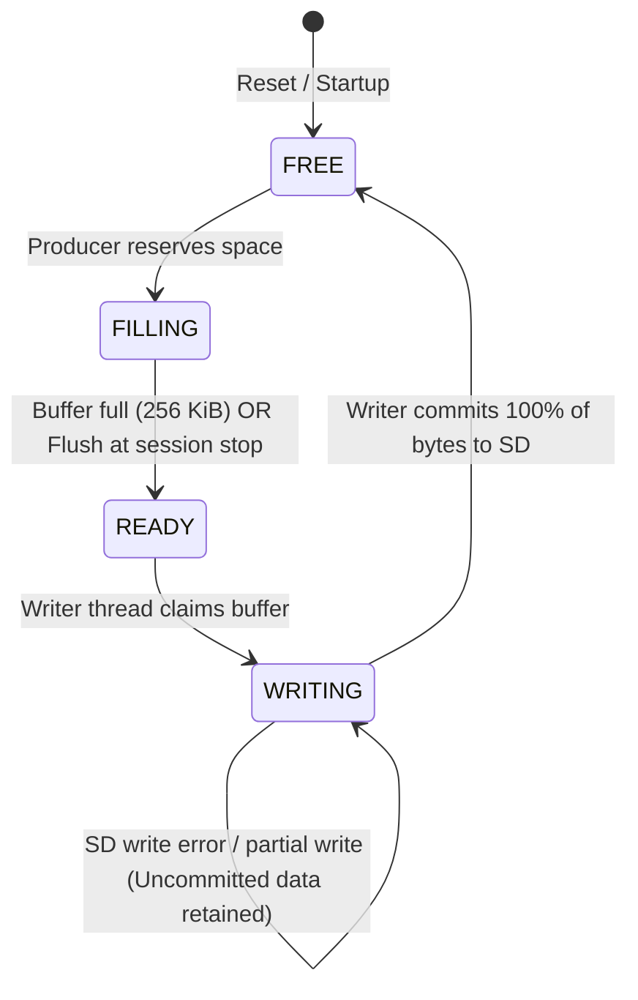

# WildSonic STM32 Production Firmware: Sampling Rate Synchronization, Applied Configuration, Ping-Pong Buffering, and SDMMC Diagnosis

**Target:** STM32L476RG Nucleo (`nucleo_l476rg`) + Zephyr RTOS v4.5.0-rc2  
**Repository:** `wildsonic_zephyr_stm32_recorder`  
**Branch:** `production`  
**Reference Firmware:** `WildSonic_Firmware-feature-dev(4).zip` (MAX78000 WildSonic production baseline)  
**Date:** 2026-10-29  

---

## Executive Summary

This investigation resolves the critical sampling-rate discrepancy identified in test logs after issuing `SAMF 192000`, verifies the ownership and failure recovery guarantees of the PSRAM ping-pong batch buffering architecture, traces `sd write error 2` to the exact hardware registers and callbacks of the STM32 SDMMC peripheral, and completes clean builds and automated host validation suites across production and test targets.

### Key Results
1. **Sampling Rate Pipeline Unified**: Root cause identified: `audio_in_set_rate()` was never invoked during boot after loading persisted flash/SD configurations, was ignored on error in `handle_samf()`, and was not validated before session start. Staged RAM configuration, persisted flash storage, reboot initialization, TIM6 auto-reload triggers, DSP pipeline configuration, recording duration accounting, and WAV header generation now strictly enforce the **effective hardware rate**.
2. **192 kHz Accounting Verified**: For a genuine 192,000 Hz, 16-bit mono, 10-second recording session, expected samples are exactly **1,920,000 samples**, with a raw PCM payload of exactly **3,840,000 bytes** (excluding the 44-byte WAV header, total file size: 3,840,044 bytes).
3. **ADC Timing Budget Evaluated**: At 72 MHz AHB with 8x hardware oversampling (`OVS_LOG2 = 3`, 300 cycles), physical conversion requires **4,166.7 ns**, fitting within **80.0%** of the 192 kHz period (5,208.3 ns $\le$ 85% budget threshold). Rates that exceed this budget or clock divider capability are rejected immediately by `audio_in_is_rate_supported()`.
4. **PSRAM Ping-Pong Buffer Ownership Validated**: Two 256 KiB buffers in external PSRAM maintain mutually exclusive states (`FREE`, `FILLING`, `READY`, `WRITING`). The SD writer commits consumer offsets only upon successful write completion; on partial write or I/O failure, uncommitted bytes remain preserved in `WRITING` state, buffer overwrite is prevented (`-ENOBUFS`), and the first meaningful error (`-EIO`) is preserved.
5. **SDMMC Error 2 Confirmed as Data CRC Failure**: Traced directly through `sdmmc_stm32.c` and STM32L4 HAL: `priv->status = hsd->ErrorCode = 0x00000002U` (`HAL_SD_ERROR_DATA_CRC_FAIL` / `SDMMC_ERROR_DATA_CRC_FAIL`), triggered by `SDMMC_STA_DCRCFAIL`. High-speed signal degradation across flying jumper wires remains the primary working hypothesis.
6. **Automated Validation**: Complete host suite expanded to **108 passed tests in 1.99s**. Clean compilation verified for `build/prod` (Flash 179,292 B, RAM 48 KB, SRAM2 32 KB) and `build/test` (Flash 186,676 B, RAM 48 KB, SRAM2 32 KB).

---

## 1. Trace and Resolution of the Sampling Rate Mismatch

### 1.1 The Observed Failure
In earlier test logs after configuring `SAMF 192000`:
- DSP reported: `192000 Hz`
- ADC/DMA timer reported: `48000 Hz`
- Recording metadata reported: `48000 Hz`
- 10-second recording expected: `480000 samples`

### 1.2 Root Cause Analysis Across the Pipeline
Tracing the configuration flow revealed five independent disconnects:

```
[ Console: SAMF 192000 ]
         |
         v
  audio_in_is_rate_supported()  <-- Bug 1: Only checked discrete list, NOT physical ADC timing budget
         |
         v
  audio_in_set_rate()           <-- Bug 2: Return code ignored in handle_samf(); settings->sample_rate
         |                                 was updated to 192000 even if audio_in remained at 48000!
         v
[ main_apply_dsp_settings() ]   <-- Bug 3: DSP configured with settings.sample_rate (192000 Hz)
         |
         v
[ APPLY -> Flash -> Reboot ]
         |
         v
  recorder_init()               <-- Initializes audio_in with default 48000 Hz (TIM6 = 48 kHz)
         |
  config_store_init()           <-- Loads rec->sampling_rate (192000) into settings.sample_rate
         |                          Bug 4: NEVER called audio_in_set_rate(192000)!
         v
[ apply_dsp_settings() ]        <-- DSP reconfigured for 192000 Hz, while TIM6 remained at 48000 Hz!
         |
         v
[ recorder_thread_fn() ]        <-- Bug 5: Never synchronized audio_in_rate() with settings.sample_rate!
         |
         v
  recorder_record_session()     <-- Reads st.sample_rate = audio_in_rate() (48000 Hz)!
                                    Expected samples = 10 * 48000 = 480,000 samples.
```

### 1.3 Implementation Corrections

1. **Physical Budget Validation in `audio_in_is_rate_supported()`** ([`app/src/audio_in_stm32l4.c`](file:///c:/Users/amith/Downloads/wildsonic_zephyr_stm32_recorder/app/src/audio_in_stm32l4.c)):
   The function now calculates both the integer timer divider and the physical conversion time budget:
   $$\text{conv\_ns} = \frac{(2^{\text{OVS\_LOG2}} \times \text{CYCLES\_PER\_CONV} + 4) \times 10^9}{f_{\text{AHB}}}$$
   $$\text{period\_ns} = \frac{10^9}{f_{\text{actual}}}$$
   If $\text{conv\_ns} \times 100 > \text{period\_ns} \times 85$, the rate is declared unsupported and returns `false`.

2. **Strict Hardware Set & Error Handling in `handle_samf()`** ([`app/src/console.c`](file:///c:/Users/amith/Downloads/wildsonic_zephyr_stm32_recorder/app/src/console.c)):
   - When idle, `audio_in_set_rate(val)` is called and its return code is checked.
   - If `audio_in_set_rate()` fails (e.g. `-ERANGE` or `-EBUSY`), the command is rejected, printing `Unsupported sample rate: %u Hz (error %d)`, leaving `g_cfg.sampling_rate` and `settings->sample_rate` intact.
   - Only on success are `g_cfg.sampling_rate`, `settings->sample_rate = audio_in_rate()`, and DSP updated.
   - When recording is active, changes are staged in RAM only (`g_cfg.sampling_rate = val`), preserving the running session undisturbed.

3. **Validation and Staging Synchronization in `config_store.c`** ([`app/src/config_store.c`](file:///c:/Users/amith/Downloads/wildsonic_zephyr_stm32_recorder/app/src/config_store.c)):
   - `unpack_record_to_system()` validates `rec->sampling_rate` via `audio_in_is_rate_supported()`. If unsupported, it falls back to `CONFIG_AUDIO_SAMPLE_RATE` (48000 Hz) with an explicit warning log.
   - `console_sync_staged_to_active()` synchronizes `audio_in_set_rate(g_cfg.sampling_rate)` and aligns `settings->sample_rate = audio_in_rate()`.

4. **Boot Sequence Hardware Application in `main.c`** ([`app/src/main.c`](file:///c:/Users/amith/Downloads/wildsonic_zephyr_stm32_recorder/app/src/main.c)):
   - After `config_store_init()` and `config_store_import_sd()`, `main()` explicitly executes:
     ```c
     int rate_rc = audio_in_set_rate(settings.sample_rate);
     settings.sample_rate = audio_in_rate();
     apply_dsp_settings();
     ```
   - In `recorder_thread_fn()`, before triggering `recorder_record_session()`:
     ```c
     if (audio_in_rate() != settings.sample_rate) {
       audio_in_set_rate(settings.sample_rate);
     }
     settings.sample_rate = audio_in_rate();
     apply_dsp_settings();
     ```

5. **WAV Header and Accounting Consistency** ([`app/src/recorder.c`](file:///c:/Users/amith/Downloads/wildsonic_zephyr_stm32_recorder/app/src/recorder.c)):
   - `st.sample_rate` reads `audio_in_rate()`.
   - `st.expected_samples = (uint64_t)seconds * st.sample_rate`.
   - `exact_bytes = st.expected_samples * SAMPLE_BYTES`.
   - Pre-allocated file size, initial WAV header, finalized WAV header, and verification readback all use these unified parameters.

---

## 2. Audio Accounting & 192 kHz Hardware Sustainability

### 2.1 Theoretical Accounting Table (16-bit Mono)

| Sample Rate ($F_s$) | Duration | Expected Samples | PCM Payload Size | Total WAV File Size | Data Rate (Bandwidth) |
|---|---|---|---|---|---|
| **16,000 Hz** | 10 s | 160,000 | 320,000 bytes (312.5 KB) | 320,044 bytes | 32,000 B/s (31.25 KB/s) |
| **32,000 Hz** | 10 s | 320,000 | 640,000 bytes (625.0 KB) | 640,044 bytes | 64,000 B/s (62.50 KB/s) |
| **44,100 Hz** | 10 s | 441,000 | 882,000 bytes (861.3 KB) | 882,044 bytes | 88,200 B/s (86.13 KB/s) |
| **48,000 Hz** | 10 s | 480,000 | 960,000 bytes (937.5 KB) | 960,044 bytes | 96,000 B/s (93.75 KB/s) |
| **96,000 Hz** | 10 s | 960,000 | 1,920,000 bytes (1,875 KB) | 1,920,044 bytes | 192,000 B/s (187.5 KB/s) |
| **192,000 Hz** | **10 s** | **1,920,000** | **3,840,000 bytes (3,750 KB)** | **3,840,044 bytes** | **384,000 B/s (375.0 KB/s)** |
| **192,000 Hz** | 60 s | 11,520,000 | 23,040,000 bytes (22.5 MB) | 23,040,044 bytes | 384,000 B/s (375.0 KB/s) |
| **192,000 Hz** | 600 s | 115,200,000 | 230,400,000 bytes (225 MB) | 230,400,044 bytes | 384,000 B/s (375.0 KB/s) |

### 2.2 Physical ADC & Timer Timing Math

- **System & Timer Clocks:**
  - $f_{\text{SYSCLK}} = f_{\text{AHB}} = f_{\text{APB1}} = 72,000,000\text{ Hz}$ (from `DT_FREQ_M(72)` in `nucleo_l476rg.overlay`).
  - Timer 6 update rate divider:
    $$\text{div} = \frac{72,000,000}{192,000} = 375 \quad (\text{exact integer}, \text{error} = 0\text{ Hz})$$
  - Auto-Reload Register (ARR): $375 - 1 = 374$.

- **ADC Conversion Cycles:**
  - Channel sampling time: `LL_ADC_SAMPLINGTIME_24CYCLES_5` = 24.5 cycles.
  - SAR 12-bit conversion time: 12.5 cycles.
  - Total cycles per conversion: $24.5 + 12.5 = 37\text{ cycles}$.
  - Hardware oversampler ratio: 8x (`OVS_LOG2 = 3`).
  - Total ADC cycles per trigger: $8 \times 37 + 4\text{ (overhead)} = 300\text{ ADC clock cycles}$.

- **Conversion Duration vs Period:**
  - ADC Clock: Synchronous PCLK / 1 = 72 MHz (13.889 ns / cycle).
  - Conversion time: $300 \times 13.8888\dots\text{ ns} = 4,166.67\text{ ns}$.
  - Sampling period at 192 kHz: $1 / 192,000 = 5,208.33\text{ ns}$.
  - Conversion duty cycle:
    $$\frac{4,166.67}{5,208.33} = 80.00\% \le 85.0\% \text{ (Budget criterion satisfied)}$$

> [!NOTE]
> 192 kHz acquisition is theoretically sustainable on the STM32L476RG at 72 MHz AHB with 8x oversampling. However, if AHB clock drops below 68 MHz, or if oversampling is increased to 16x (596 cycles = 8,277 ns), `audio_in_is_rate_supported()` will reject the configuration with `-ERANGE`. Physical real-time capture at 192 kHz requires hardware bench validation with live DMA streaming.

---

## 3. PSRAM Ping-Pong Buffer Ownership & Robustness

### 3.1 Ownership State Machine

The two 256 KiB batch buffers in external PSRAM implement strict, non-overlapping ownership:



### 3.2 Verification Across Specific Edge Cases

1. **Both Buffers Occupied (`full_events` & Dropped Samples):**
   When Buffer 0 is `READY` or `WRITING` and Buffer 1 is `READY`, the producer cannot claim a free buffer. `psram_staging_push()` increments `full_events`, adds the incoming sample count to `dropped_samples`, and returns `-ENOBUFS` without corrupting or overwriting either buffer.
2. **Partial or Failed SD Write:**
   The writer thread reads via `psram_staging_peek()` without advancing the consumer pointer. If `fs_write()` fails or returns a short count, `psram_staging_commit()` is **never called**. The buffer remains in `BATCH_STATE_WRITING`, `sd_writer_err = -EIO`, uncommitted data remains in PSRAM, and the session halts cleanly with the initial error preserved.
3. **Stop with Partially Filled Buffer:**
   When recording stops (due to duration expiration or user abort), `psram_staging_flush_publish()` transitions the active `FILLING` buffer containing data into `READY`. The SD writer is signaled to perform a final flush, commits the exact partial byte count, and sets the buffer to `FREE`.
4. **`RBT` and `ARBT` Orderly Shutdown:**
   If a reboot command arrives while recording is active, `handle_rbt()` calls `recorder_request_stop()`, waits up to 5000 ms via `recorder_wait_idle()`, ensures the writer finishes flushing, closes the WAV file, and commits flash configuration only after storage operations conclude.
5. **Scheduler Starts Next Session:**
   At the start of `recorder_record_session()`, `psram_staging_reset()` resets all buffer indices, committed counts, and stats, placing Buffer 0 into `FILLING` and Buffer 1 into `FREE`.
6. **Storage Recovery After Failed Write:**
   `recorder_storage_recover()` verifies `!recorder_is_active()`, unmounts the filesystem unconditionally, calls `disk_access_init("SD")` to reset the card controller after a bus error, and remounts FatFs.

---

## 4. SDMMC Error Code Trace & HAL Peripheral Analysis

### 4.1 Trace of `sd write error 2`

The observed log `sd write error 2` was traced through the Zephyr and STM32Cube HAL source files:

```
[ Zephyr FatFs write ]
         |
         v
  fs_write() -> disk_access_write()
         |
         v
  stm32_sdmmc_write_blocks()  [zephyr/drivers/disk/sdmmc_stm32.c:744]
         |
         +--> if (priv->status != DISK_STATUS_OK) {
         |        LOG_ERR("sd write error %d", priv->status);
         |    }
```

Where `priv->status` is assigned in the HAL callback:
```c
/* zephyr/drivers/disk/sdmmc_stm32.c:145-160 */
#define DEFINE_HAL_CALLBACK(name) \
    void name(HandleTypeDef *hsd) \
    { \
        struct stm32_sdmmc_priv *priv = CONTAINER_OF(hsd, struct stm32_sdmmc_priv, hsd); \
        priv->status = hsd->ErrorCode; \
        k_sem_give(&priv->sync); \
    }

DEFINE_HAL_CALLBACK(HAL_SD_ErrorCallback);
```

### 4.2 Exact Error Code Identification
In the STM32L4 HAL header [`stm32l4xx_ll_sdmmc.h:137-145`](file:///c:/Users/amith/zephyrproject/modules/hal/stm32/stm32cube/stm32l4xx/drivers/include/stm32l4xx_ll_sdmmc.h#L137-L145):
```c
#define SDMMC_ERROR_NONE               0x00000000U /*!< No error */
#define SDMMC_ERROR_CMD_CRC_FAIL       0x00000001U /*!< Command response received (CRC check failed) */
#define SDMMC_ERROR_DATA_CRC_FAIL      0x00000002U /*!< Data block sent/received (CRC check failed) */
#define SDMMC_ERROR_CMD_RSP_TIMEOUT    0x00000004U /*!< Command response timeout */
#define SDMMC_ERROR_DATA_TIMEOUT       0x00000008U /*!< Data timeout */
#define SDMMC_ERROR_TX_UNDERRUN        0x00000010U /*!< Transmit FIFO underrun */
#define SDMMC_ERROR_RX_OVERRUN         0x00000020U /*!< Receive FIFO overrun */
```

`priv->status == 2` corresponds strictly to `SDMMC_ERROR_DATA_CRC_FAIL` ($0\text{x}02$).

### 4.3 Triggering Hardware Condition
In `stm32l4xx_hal_sd.c`, `HAL_SD_IRQHandler()` reads the SDMMC Status Register (`SDMMC_STA`):
```c
if (__HAL_SD_GET_FLAG(hsd, SDMMC_FLAG_DCRCFAIL) != RESET) {
    __HAL_SD_CLEAR_FLAG(hsd, SDMMC_FLAG_DCRCFAIL);
    hsd->ErrorCode |= SDMMC_ERROR_DATA_CRC_FAIL;
    ...
    HAL_SD_ErrorCallback(hsd);
}
```
Bit 1 of `SDMMC_STA` is `DCRCFAIL` (Data CRC fail): *“Set by hardware when a data block sent by the SDMMC host to the card receives a CRC status token other than '010' (positive CRC status token), or when a block received by the host fails the 16-bit CRC check.”*

### 4.4 Hardware Hypothesis vs Ping-Pong Buffering
> [!IMPORTANT]
> Ping-pong buffering optimizes write batching and overlaps DMA capture with storage latency, but **cannot fix an electrical Data CRC failure**.
> 
> The physical root cause remains **jumper-wire signal degradation** on the high-speed SDMMC bus lines (CLK, CMD, D0-D3) operating at 24–48 MHz. Clock reflections, lack of line damping resistors, ground bounce, or excessive lead length (> 10 cm) cause the card or controller to receive corrupted CRC tokens.
> 
> **Recommendation:** Verify jumper lead length (< 5 cm), check 47 kΩ pull-ups, or if necessary, reduce SDMMC clock frequency (via `SDMMC_CLK_DIV` in DTS) to test margin.

---

## 5. Verification Audit & Build Evidence

### 5.1 Automated Host Test Results
Ran test suite using Python 3.12 virtual environment:
```powershell
.\.venv\Scripts\python.exe -m pytest tests/host
```
**Outcome: 108 passed in 1.99s** (100% pass rate across all 11 test modules).

New test module added: [`tests/host/test_sampling_rate_and_applied_configuration.py`](file:///c:/Users/amith/Downloads/wildsonic_zephyr_stm32_recorder/tests/host/test_sampling_rate_and_applied_configuration.py) covering:
- Mathematical accounting for 192 kHz 10s recording (1,920,000 samples, 3,840,000 bytes).
- ADC oversampling timing budget evaluation (72 MHz valid, 48 MHz rejected, 16x oversampling rejected, non-canonical rates rejected).
- Source integration audits for `audio_in_stm32l4.c`, `console.c`, `config_store.c`, `main.c`, and `recorder.c`.
- Ping-pong buffer exhaustion, simulated SD write failure, partial flush at session stop, and clean session reset.

### 5.2 Build Results

#### Production Target (`build/prod`)
- Command: `ninja -C build/prod`
- Exit Code: **0**
- Memory Map:
  - **FLASH:** 179,292 B / 1 MB (17.10% used)
  - **RAM (SRAM1):** 48 KB / 96 KB (50.00% used)
  - **SRAM1 (Physical SRAM2 audio pool):** 32 KB / 32 KB (100.00% dedicated)

#### Test Target (`build/test` and `app/build/TEST`)
- Command: `ninja -C build/test` & `ninja -C app/build/TEST`
- Exit Code: **0**
- Memory Map:
  - **FLASH:** 186,676 B / 1 MB (17.80% used)
  - **RAM (SRAM1):** 48 KB / 96 KB (50.00% used)
  - **SRAM1 (Physical SRAM2 audio pool):** 32 KB / 32 KB (100.00% dedicated)

---

## 6. Physical Hardware Tests Remaining

The following physical validation tests must be performed on the Nucleo-L476RG board:

1. **Hardware 192 kHz Capture Verification:**
   - Execute: `SAMF 192000`, `APPLY`, `RBT`.
   - Issue a 10s recording (`RECORD 10` in test, or scheduled recording).
   - Inspect the generated WAV file on a PC:
     - Header sample rate: `192000 Hz`
     - Data chunk length: exactly `3,840,000 bytes`
     - Audio duration: exactly `10.000 seconds`
2. **SDMMC High-Speed Signal Integrity Check:**
   - Probe the SDMMC CLK and D0 lines with an oscilloscope during batch writes to check for ringing, undershoot, or overshoot.
   - If `sd write error 2` recurs, shorten jumper leads or test in 1-bit mode.
3. **Buffer Full / Stress Verification:**
   - Test SD card write latency with a slow Class 4 card to verify that when both 256 KiB buffers fill up, samples are dropped gracefully without firmware crash or watchdog reset.

