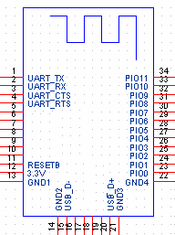

# HMSoft Application and V707 Firmware for HM10 BLE Module

This directory contains the HMSoft application along with the V707 firmware version bin file for the HM10 BLE module.

> [!NOTE]
> The V707 update via HMSoft (serial) only works if V540 or above is already present on the module. Therefore, V540 must be uploaded first (or already present) before you can update to V707. If your module has an older firmware or is bricked, you can use the CC Debugger method to flash V540 first.

---

## Steps to Update the Firmware (HMSoft / Serial Method)

1. Connect a USB to TTL converter with the HM10 BLE module.

2. First, check the current firmware version of the BLE module by sending `AT+VERR?\r\n` or `AT+VERS?\r\n` or `AT+VERSION?\r\n`.

3. Send the command `AT+SBLUP\r\n` to put the module into firmware update mode.

4. If the firmware is not V707, open the HMSoft application (`HMSoft.exe`) available in the present directory.

5. Choose the proper COM port and the bin file (`HMSoft.bin`) present in the same directory, then flash the firmware.

6. Once successfully updated, check the baud rate by sending an `AT\r\n` command and observe the `OK` response.

7. If the baud rate is not 115200, set it to 115200 by sending `AT+BAUD4`. Cross-verify that it updated properly and that it retains the setting after a power cycle.

8. Now check the firmware version; it should be V707.

---

## CC Debugger Based Steps (Arduino)

The CC2540 provides debug access through three pins. They are connected to the HM-10's pins as follows:

| Signal          | HM-10 Pin |
|-----------------|-----------|
| DEBUG_CLOCK (DC)| Pin 7     |
| DEBUG_DATA (DD) | Pin 8     |
| RESET_N         | Pin 11    |

The HM-10's pin numbers can be found in its datasheet (HM10 Pins).  
[Download the HM-10 Datasheet](Original_datasheet_HM-10.pdf)



Now you have to solder three wires to these three pins.

### Flash Firmware (Arduino UNO)

Connect the three wires to your Arduino UNO as follows:

| Signal  | Arduino UNO Pin |
|---------|-----------------|
| DD      | Pin 6           |
| DC      | Pin 5           |
| RESET_N | Pin 4           |

Now upload the `CCLoader.ino` to your Arduino. Now you can send your binary-file to the Arduino which flashes it onto to the CC2541. Open a command line and type:

```bat
cd CCLoader
CCLoader.exe <COM Port> CC2541hm10v540.bin 0
```

Now the firmware gets uploaded which may take a few minutes. I have added necessary files in the CCLoader folder.