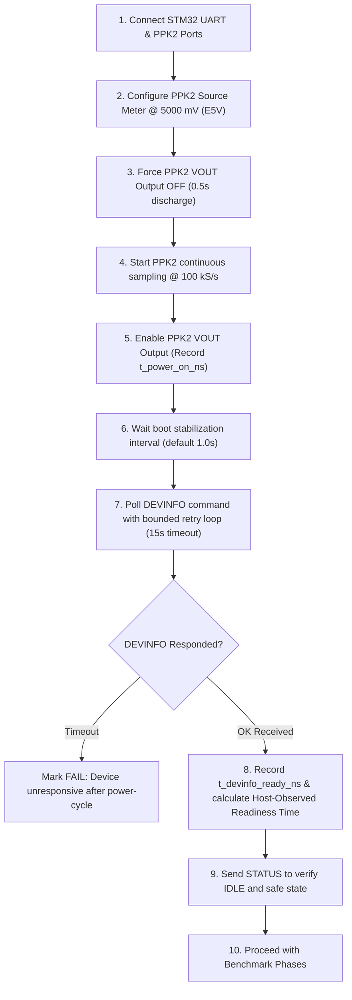

# STM32 Measurement, Benchmarking, and Reporting Tool

The `measurement_tool` package is an automated hardware benchmark orchestrator, power profiler, and comparison reporter designed for evaluating the **STMicroelectronics STM32L476RG** acoustic recorder against the reference **Maxim Integrated MAX78000** platform.

The tool uses a **Nordic Semiconductor Power Profiler Kit II (PPK2)** as the programmable power controller and precision measurement instrument, operating alongside the **STM32 ST-Link Virtual COM Port**.

---

## 1. Hardware Architecture & Setup

### Dual Independent Serial Interfaces
Two independent serial interfaces must be connected to the host PC:
1. **STM32 ST-Link Virtual COM Port** (e.g. `COM30` on Windows, `/dev/ttyACM0` on Linux):
   - Transmits console commands and captures firmware execution telemetry at 115200 baud.
2. **Nordic PPK2 USB Serial Port** (e.g. `COM31` on Windows, `/dev/ttyACM1` on Linux):
   - Controls DUT power output and samples continuous current at 100 kS/s.

> [!CAUTION]
> **Port Collision Warning**: Never configure the PPK2 port to the same COM port as the STM32 UART port. The tool validates port assignments and immediately halts if a collision is detected.
> **Nordic App Conflict**: Ensure the **nRF Connect Power Profiler desktop application is closed** before executing benchmarks, as it holds an exclusive serial lock on the PPK2 COM port.

---

### NUCLEO-L476RG Power Jumper Configuration (ST UM1724)

To power the STM32 Nucleo-64 board cleanly through the PPK2 Source Meter and measure total board energy without back-powering from the ST-Link USB:

| Hardware Element | Configuration | ST UM1724 Specification / Reason |
| :--- | :--- | :--- |
| **JP5 Jumper** | **Pins 2–3 (E5V)** | Selects external 5 V supply (E5V) as the board power source instead of USB 5 V (U5V). |
| **JP1 Jumper** | **REMOVED** | Isolates ST-Link current and prevents back-powering between USB and target board. |
| **PPK2 VOUT** | **Connect to E5V** | Connect PPK2 VOUT pin to Nucleo CN7 pin 6 or CN6 pin 3 (E5V). |
| **PPK2 GND** | **Connect to GND** | Connect PPK2 GND pin to Nucleo CN7 pin 20 or CN6 pin 4 (GND). |
| **PPK2 Supply Voltage** | **5000 mV (5.0 V)** | The on-board LD1117S33 LDO regulates 5.0 V E5V down to 3.3 V for the MCU, PSRAM, and SD card. |

> [!WARNING]
> **Voltage Domain Separation**: Never connect the 5.0 V PPK2 E5V output directly to the Nucleo's 3.3 V rail or `VDD` pin! If directly powering the 3.3 V rail, configure `--power-rail VDD --voltage 3300`.

---

## 2. PPK2 Software Driver & Dependencies

The PPK2 controller is implemented in [`measurement_tool/ppk2_controller.py`](file:///c:/Users/amith/Downloads/wildsonic_zephyr_stm32_recorder/measurement_tool/ppk2_controller.py).

- **Driver Library**: [`ppk2-api`](https://pypi.org/project/ppk2-api/)
- **Pinned Version**: `0.9.2` (Source: [IRNAS ppk2-api-python](https://github.com/IRNAS/ppk2-api-python))
- **Install Command**:
  ```bash
  pip install ppk2-api==0.9.2
  ```

### Automated Driver Capabilities:
- Auto-discovers PPK2 COM ports (Nordic VID `0x1915`, PID `0xC00A`).
- Validates connection and calibration modifiers on startup.
- Configures Source Meter mode at user-specified voltage (800 mV – 5000 mV).
- Enables and disables DUT power programmatically with monotonic timestamps (`time.monotonic_ns()`).
- Continuous background sampling at 100 kS/s using high-throughput non-blocking worker threads.
- Automatically exports master CSV and phase-specific CSV files into `data/ppk2/`.
- **Safety Interlock**: Rejects power removal if storage finalization or recording is active.

---

## 3. Banner-Independent Hardware Boot Sequence

The benchmark does **not** rely on `System initialization complete`, any specific Zephyr kernel boot banner, or the `RBT` software reboot command for hardware reset.

Initial board reset is performed strictly via **PPK2 Source Meter output control**:



---

## 4. The 9-Phase Automated Benchmark (Phases A through I)

The benchmark executes 9 sequential hardware phases, with continuous PPK2 power measurement:

1. **Phase A: PPK2 Power-Controlled Cold Boot**:
   - Power OFF $\rightarrow$ sampling start $\rightarrow$ Power ON $\rightarrow$ DEVINFO poll $\rightarrow$ measure host readiness time & inrush power.
2. **Phase B: Active Idle Measurement**:
   - Holds console idle state for 5 seconds $\rightarrow$ measures idle baseline current and power.
3. **Phase C: Recording Performance & Power**:
   - Configures pipeline (`SAMF 192000`, `BTPS 16`, `RECT 10`, `UCUTOFF 24000`).
   - Measures ADC acquisition, DMA workers, and PSRAM staging power.
4. **Phase D: Active SD Write Performance & Power**:
   - Executes SD benchmark matrix / batch write $\rightarrow$ extracts write throughput (KB/s) and worst-case batch write latency.
5. **Phase E: SD Read Performance & Power**:
   - Scans filesystem clusters (`STOR`) $\rightarrow$ measures read power and transaction throughput.
6. **Phase F: Stop 2 Entry and Sleep Power**:
   - Sets sleep interval (`SLEEP 5`).
   - **PPK2 power remains continuously ON!** Never cuts power during sleep.
   - Measures Stop 2 deep sleep current continuously.
7. **Phase G: RTC Wake-Up & Transient Power**:
   - Detects RTC wake event $\rightarrow$ measures wake latency, transient peak current, and clock recovery energy.
8. **Phase H: Peripheral Recovery & Restart Readiness**:
   - Verifies SD card, PSRAM, and Audio recovery $\rightarrow$ measures wake-to-recording readiness.
9. **Phase I: Final Recording Integrity & Storage Verification**:
   - Verifies `WAV_VERIFIED == PASS`, zero sample loss, and complete sample accounting.
   - Safe shutdown interlock verifies storage is idle before power-down.

---

## 5. Command-Line Usage

### 1. First PPK2-Controlled Hardware Benchmark
Run the complete 9-phase hardware benchmark on connected hardware:

```powershell
python -m measurement_tool.main run-test `
  --category ppk2-benchmark `
  --port COM30 `
  --ppk2-port AUTO `
  --voltage 5000 `
  --power-rail E5V `
  --rate 192000 `
  --duration 10 `
  --sleep-seconds 5 `
  --evidence-type HARDWARE `
  --test-id STM32-PPK2-HW-001
```

### 2. PPK2 Power-Cycle Boot Test Only
Test power-controlled cold boot and host-observed readiness time:

```powershell
python -m measurement_tool.main run-test `
  --category ppk2-boot `
  --port COM30 `
  --ppk2-port AUTO `
  --voltage 5000 `
  --boot-stabilize 1.0 `
  --devinfo-timeout 15.0 `
  --evidence-type HARDWARE `
  --test-id STM32-PPK2-BOOT-001
```

### 3. Software Simulation / Mock Mode
Validate the entire 9-phase benchmark and workbook update without hardware attached:

```powershell
python -m measurement_tool.main run-test `
  --category ppk2-benchmark `
  --mock `
  --duration 2 `
  --sleep-seconds 1 `
  --test-id STM32-PPK2-SIM-001
```

---

## 6. Generated Output Artifacts

Every benchmark run automatically generates and saves:
1. **Raw UART Log**: `data/stm32/raw_logs/<test_id>_<timestamp>.raw.log`
2. **Timestamped UART Log**: `data/stm32/raw_logs/<test_id>_<timestamp>.timestamped.log`
3. **Master PPK2 Telemetry CSV**: `data/ppk2/<test_id>_<timestamp>_ppk2_full.csv`
4. **Phase-Specific PPK2 CSVs**:
   - `data/ppk2/<test_id>_<timestamp>_phase_a__cold_boot.csv`
   - `data/ppk2/<test_id>_<timestamp>_phase_b__active_idle.csv`
   - `data/ppk2/<test_id>_<timestamp>_phase_c__recording.csv`
   - `data/ppk2/<test_id>_<timestamp>_phase_d__sd_write.csv`
   - `data/ppk2/<test_id>_<timestamp>_phase_e__sd_read.csv`
   - `data/ppk2/<test_id>_<timestamp>_phase_f__stop2_sleep.csv`
   - `data/ppk2/<test_id>_<timestamp>_phase_g__rtc_wakeup.csv`
   - `data/ppk2/<test_id>_<timestamp>_phase_h__peripheral_recovery.csv`
   - `data/ppk2/<test_id>_<timestamp>_phase_i__storage_verification.csv`
5. **Parsed JSON Results**: `data/parsed/<test_id>_<timestamp>.json`
6. **Comparison Workbook**: `data/reports/stm32_vs_max78000.xlsx` (all 11 sheets updated with backup)
